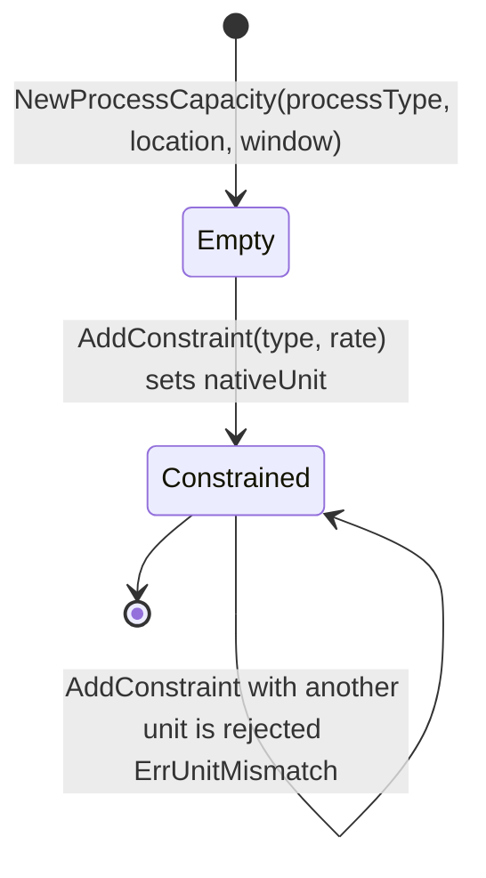
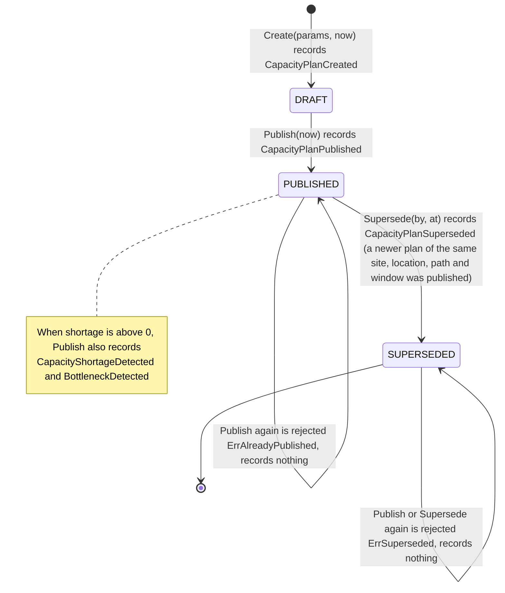
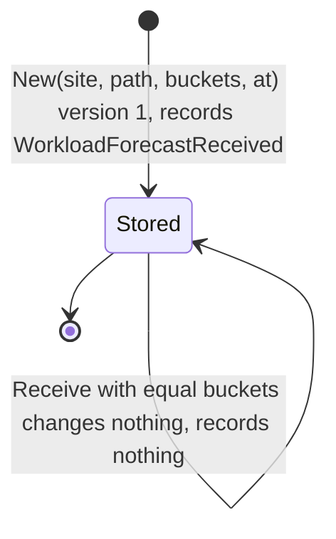
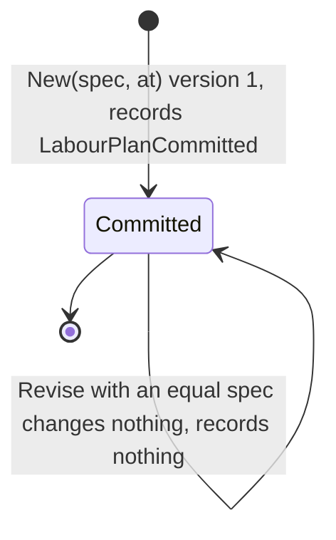

# Aggregate design canvas

Following the ddd-crew [Aggregate Design Canvas v1.1](https://github.com/ddd-crew/aggregate-design-canvas),
one section per aggregate root in `internal/domain`. There are four:
`ProcessCapacity` and `CapacityPlan` (the capacity side), and
`WorkloadForecast` and `LabourPlan` (the requirement side, ADR 0023). Read
models are listed at the end.

## ProcessCapacity

### 1. Name

`ProcessCapacity` (`internal/domain/processcapacity/process_capacity.go`).

### 2. Description

The usable throughput of one warehouse process at one site for one time
window: the minimum across its registered constraints (LABOR, LOCATION,
EQUIPMENT, STATION, CONVEYOR, BUFFER, REPLENISHMENT). Identity is
`(ProcessType, Location, CapacityWindow)`, an exact key; whether it applies to a
planning window is decided by window coverage outside the aggregate
(`CapacityWindow.Covers`, ADR 0003).

### 3. State Transitions

The aggregate has no status enum. Its only state change is the first
`AddConstraint`, which fixes the native unit (`nativeUnitSet`).

Source: `internal/domain/processcapacity/process_capacity.go`,
`internal/application/usecases/register_process_capacity_constraint.go`.
Omits: deletion (no code deletes a `ProcessCapacity` except migration `0005`'s
one-off cleanup of legacy rows). `Empty` is transient: the use case always
adds a constraint before saving.

### 4. Enforced Invariants

| Invariant | Enforced by |
| --- | --- |
| All constraints share one native unit, set by the first constraint | `AddConstraint` returns `ErrUnitMismatch` |
| One rate per constraint type; re-registering replaces it in place, keeping its position | `AddConstraint` (`order` + `constraints` map) |
| A rate's quantity is not negative and its period is positive | `NewCapacityRate`: `ErrNegativeQuantity`, `ErrNonPositivePeriod` |
| The window's end is strictly after its start | `NewCapacityWindow`: `ErrInvalidWindow` |
| No effective rate without a constraint | `EffectiveRate` returns `ErrNoConstraints` |
| Ties in the effective rate go to the earliest-registered constraint | `EffectiveRate` iterates `order` (persisted as `ordinal`) |

### 5. Corrective Policies

- A Kafka `ShiftPlanCommitted` that fails one of these rules is a deterministic
  rejection (`usecases.IsDomainValidationError`): it is logged, its
  processed-event claim is committed and it is never retried.
- A REST caller gets `400 invalid-capacity-window`, `422 negative-quantity` /
  `non-positive-period`, or `409 unit-mismatch` (statuses from `statusFor` in
  `internal/adapters/inbound/http/errors.go`); an MCP caller gets the same
  slugs as tool errors. Either must correct the request.

### 6. Handled Commands

| Command | Use case | Inbound |
| --- | --- | --- |
| `RegisterProcessCapacityConstraintCommand` | `RegisterProcessCapacityConstraint.Handle` (find or create, `AddConstraint`, save) | `POST /process-capacities`, MCP `register_process_capacity_constraint`, and `LaborCapacityConsumer` |

### 7. Created Events

| Event | Raised | Published as |
| --- | --- | --- |
| `ProcessCapacityRegistered` | `AddConstraint`, when the first (native) constraint registers the aggregate | `com.warehouse.wes.warehouse-planning.processcapacity.ProcessCapacityRegistered` |
| `ProcessCapacityChanged` | `AddConstraint`, when a registration moves the effective rate (value, binding, or both); a registration it does not notice raises nothing | `com.warehouse.wes.warehouse-planning.processcapacity.ProcessCapacityChanged` |

`subject` and the Kafka key are the aggregate's canonical identity
`<processType>/<location>/<windowStart>/<windowEnd>`; the events are outboxed
in the same unit of work as the save and get no analytics copy (plan facts
only, ADR 0005).

### 8. Throughput (estimate)

*Estimate, not measured.* Writes: one per `ShiftPlanCommitted` fan-out line
(a few per shift plan, a handful of shift plans per site per day) plus rare
operator registrations. Reads: once per path step on every path-capacity query
and plan creation (`FindCovering`). Concurrency on one instance is low: two
writes to the same `(process, site, window)` are rare.

### 9. Size (estimate)

*Estimate.* Up to 7 constraints per instance (one per `ConstraintType`).
Lifetime is the length of its window (hours to a few days); instances are never
deleted, so the table grows with every committed shift.

## CapacityPlan

### 1. Name

`CapacityPlan` (`internal/domain/capacityplan/capacity_plan.go`).

### 2. Description

The demand assigned to a warehouse site and planning window, evaluated against
the composed capacity of one `ProcessPath`: path capacity (ORDER per hour),
capacity over the window, shortage and bottleneck step, plus the informational
binding constraint, composition warnings and (ADR 0022) the labour each step
of the path requires (`labour_requirement`, computed at creation from the
labour-standard copy and stored with the plan; a later standard revision never
rewrites it). Identity is a UUID string; the
natural key `(WarehouseID, PlanningWindow)` is not unique. The aggregate does
no I/O: `Create` receives the already-computed path rate.

### 3. State Transitions

Source: `internal/domain/capacityplan/capacity_plan.go` (`StatusDraft`,
`StatusPublished`, `Create`, `Publish`), `internal/domain/capacityplan/events.go`.
Omits: `Rehydrate`, which rebuilds a stored plan in either state without
recording events, and the absence of any delete or un-publish.

### 4. Enforced Invariants

| Invariant | Enforced by |
| --- | --- |
| id, warehouse id, location and process path id are not blank | `Create` returns `ErrRequiredField` |
| Assigned demand is not negative (zero is valid) | `Create` returns `ErrNegativeDemand`; also `CHECK (assigned_demand >= 0)` |
| The path rate is an ORDER rate | `Create` returns `ErrPathRateNotOrder` |
| `shortage = max(0, demand - capacityOverWindow)`, never negative; equal is not a shortage | `Create` (`math.Max`); `CHECK (shortage >= 0)` |
| A plan is published at most once | `Publish` returns `ErrAlreadyPublished` |
| A superseded plan is terminal: it is never published or superseded again | `Publish` and `Supersede` return `ErrSuperseded` |
| At most one PUBLISHED plan per `(site_id, location, path_id, window)` | `Supersede` in the publish unit of work; partial unique index `capacity_plans_one_published_per_key` (migration 0017) |
| Each recorded event is handed over exactly once | `PullEvents` clears the slice |
| The window is valid | `processcapacity.NewCapacityWindow` in the use case (`ErrInvalidWindow`); `CHECK (window_end > window_start)` |

### 5. Corrective Policies

- An omitted `assigned_demand` with no expected orders is rejected
  (`ErrMissingAssignedDemand`, `422 missing-assigned-demand`) rather than
  creating a zero-demand plan (ADR 0004).
- A second publish returns `409 capacity-plan-already-published` and queues no
  event, so downstream consumers never see the shortage twice.
- Publishing a plan supersedes the plan published before it for the same key
  (`CapacityPlanSuperseded`, queued before the newer plan's `CapacityPlanPublished`);
  publishing a SUPERSEDED plan returns `409 capacity-plan-superseded` (ADR 0024).
- Concurrent publishes of one plan serialize on the Postgres row lock taken by
  `FindByID` inside the unit of work.

### 6. Handled Commands

| Command | Use case | Inbound |
| --- | --- | --- |
| `CreateCapacityPlanCommand` | `CreateCapacityPlan.Handle` | `POST /capacity-plans`, MCP `create_capacity_plan` |
| publish by id | `PublishCapacityPlan.Handle` | `POST /capacity-plans/{id}/publications`, MCP `publish_capacity_plan` |

### 7. Created Events

| Event | When | Full CloudEvents type |
| --- | --- | --- |
| `CapacityPlanCreated` | `Create` | `com.warehouse.wes.warehouse-planning.capacityplan.CapacityPlanCreated` |
| `CapacityPlanPublished` | `Publish`, always | `com.warehouse.wes.warehouse-planning.capacityplan.CapacityPlanPublished` |
| `CapacityShortageDetected` | `Publish`, only when `shortage > 0` | `com.warehouse.wes.warehouse-planning.capacityplan.CapacityShortageDetected` |
| `BottleneckDetected` | `Publish`, only when `shortage > 0` | `com.warehouse.wes.warehouse-planning.capacityplan.BottleneckDetected` |

Each is written twice by the outbox: on `warehouse.warehouse-planning.events`
and on `warehouse.warehouse-planning.analytics`, under one CloudEvents id.

### 8. Throughput (estimate)

*Estimate, not measured.* Created by planners or the ops agent's tooling a few
times per site per shift; published once. No hot instance: each plan is
written twice in its life (create, publish) and then only read.

### 9. Size (estimate)

*Estimate.* 2 to 4 domain events per instance over its lifetime (Created;
Published; plus ShortageDetected and BottleneckDetected when short), i.e. 4 to
8 outbox rows. The row is small (scalar fields, a short warnings array) and
lives forever; there is no archival.

## WorkloadForecast

### 1. Name

`WorkloadForecast` (`internal/domain/workloadforecast/forecast.go`, type
`Forecast`). It was wes-work-planning's `ChargeForecast` (ADR 0023 decision 1).

### 2. Description

The volume a process path is expected to receive at one site, as CPT buckets
(`{cpt, quantity}` in units). Identity is `(site_id, path_id)`; `site_id` is a
canonical facility-layout site code. One forecast per identity: a receipt
replaces the buckets as a whole. It is the input the labour plan derives
omitted heads from (`QuantityDueIn`).

### 3. State Transitions

Source: `internal/domain/workloadforecast/forecast.go` (`New`, `Receive`,
`Rehydrate`), `internal/application/usecases/workload_forecast.go`.
Omits: `Rehydrate`, which rebuilds a stored row and re-checks every invariant;
there is no delete.

### 4. Enforced Invariants

| Invariant | Enforced by |
| --- | --- |
| `site_id`, `path_id` and the receipt time are set | `New`, `Receive`, `Rehydrate` return `ErrRequiredField`; `CHECK (site_id <> '')`, `CHECK (path_id <> '')` |
| At least one bucket | `ErrNoBuckets` (wes's rule, moved verbatim); `CHECK` on `jsonb_array_length(buckets) >= 1` |
| Every bucket has a `cpt` and a non-negative whole quantity | `ErrMissingCPT`, `ErrNegativeQuantity`; a fractional quantity is `400 malformed-json` at the adapter |
| A receipt only replaces the forecast of the same site and path | `Receive` returns `ErrIdentityMismatch` |
| Equal buckets (same order, instants compared with `Equal`) change nothing: same version, same `received_at`, no event | `Receive` (`slices.EqualFunc`) |
| The version starts at 1 and moves by one per changing receipt | `New`, `Receive`; `Rehydrate` refuses `version < 1` (`ErrInvalidVersion`); the repository updates only `WHERE version = new - 1` |

### 5. Corrective Policies

- A concurrent receipt that moved the stored version between load and save is
  a `ports.ErrVersionConflict`; the use case re-runs the whole unit once and
  a second conflict is `409 version-conflict`.
- No bucket in a shift is no data: the labour plan refuses to derive heads
  from it (`422 missing-planned-heads`) instead of planning zero heads.

### 6. Handled Commands

| Command | Use case | Inbound |
| --- | --- | --- |
| `ReceiveWorkloadForecastCommand` | `ReceiveWorkloadForecast.Handle` (load, `New` or `Receive`, save, outbox) | `PUT /workload-forecasts/{site_id}/{path_id}` (no Idempotency-Key) |
| read by `(site_id, path_id)` | `GetWorkloadForecast.Handle` | `GET /workload-forecasts/{site_id}/{path_id}` |

REST only: no MCP tool, no A2A skill (ADR 0023 decision 7).

### 7. Created Events

| Event | When | Full CloudEvents type |
| --- | --- | --- |
| `WorkloadForecastReceived` | `New`, and `Receive` when the buckets changed | `com.warehouse.wes.warehouse-planning.workloadforecast.WorkloadForecastReceived` |

Payload: `site_id`, `path_id`, `total_quantity`, `bucket_count`,
`received_at`, `version` (totals, not the buckets). Key and `subject`
`<site_id>/<path_id>`; written to both topics.

### 8. Throughput (estimate)

*Estimate, not measured.* A few receipts per path and site per shift, from a
planner or the warehouse-day simulation. Reads: one per labour plan commit
that derives heads, plus operator reads.

### 9. Size (estimate)

*Estimate.* One row per `(site, path)`, overwritten every shift; a handful of
buckets (one per CPT) per row. The pick-load annotations wes carried per bucket
(`sku`, `pickUnit`, `handles`, `cubeMm3`, `weightG`) are not stored.

## LabourPlan

### 1. Name

`LabourPlan` (`internal/domain/labourplan/plan.go`, type `Plan`, content
`Spec`). It was wes-work-planning's `PathPlan` (ADR 0023 decision 2).

### 2. Description

The heads one process path needs for one shift at one site, at a planned rate
for a number of hours: the requirement this context publishes. Identity is
`(site_id, shift_id, path_id)`. `planned_heads` is either sent
(`heads_source` `request`) or derived from the stored workload forecast
(`heads_source` `forecast`): `ceil(units with a cpt in
[shift_start, shift_start + hours) / (rate x hours))`. The drift against the
heads workforce-management committed lives in the same package
(`drift.go`, `commitment.go`) but never changes the plan.

### 3. State Transitions

Source: `internal/domain/labourplan/plan.go` (`New`, `Revise`, `Rehydrate`,
`DeriveHeads`), `internal/application/usecases/labour_plan.go`.
Omits: `Rehydrate` and the absence of any delete. A drift, recorded on the
commitment, is not a plan state.

### 4. Enforced Invariants

| Invariant | Enforced by |
| --- | --- |
| `site_id`, `shift_id`, `path_id` are not blank | `ErrRequiredField`; `CHECK (... <> '')` on all three |
| `planned_heads` and `installed_stations` are whole numbers from 0 to 2147483647 | `ErrInvalidCount` (`MaxCount`); `INTEGER` columns with `CHECK (>= 0)` |
| `planned_heads <= installed_stations` | `ErrHeadsExceedStations` (wes's rule, moved verbatim); table `CHECK (planned_heads <= installed_stations)` |
| `rate_units_per_hour > 0` and `hours > 0`, both finite | `ErrInvalidRate`, `ErrInvalidHours`; `CHECK (... > 0 AND ... < 'Infinity')` |
| `rate x heads x hours` is finite | `ErrThroughputNotFinite` (wes's rule, moved verbatim) |
| `heads_source` is `request` or `forecast` | `ErrUnknownHeadsSource`; `CHECK (heads_source IN ('request', 'forecast'))` |
| A revision only changes the plan of the same key | `Revise` returns `ErrIdentityMismatch` |
| An equal spec changes nothing: same version, no event | `Revise` (`Spec.equal`, `shift_start` compared with `Equal`) |
| Omitted heads are derived only from data: no `shift_start`, no forecast, or zero buckets in the shift is refused, never zero heads | `CommitLabourPlan.deriveHeads` returns `usecases.ErrMissingPlannedHeads` |

`installed_stations` stays caller-supplied. When the facility-layout tally
knows at least one but fewer stations of the activity named like the path
(path id upper-cased) the answer carries a warning; the number is never
replaced and the warning is never stored (`stationWarnings`, every read).

### 5. Corrective Policies

- `ports.ErrVersionConflict` re-runs the whole unit once; a second one is
  `409 version-conflict`.
- A changed plan surfaces the drift against the stored commitment in the same
  unit of work (`surfaceDrift`): raised only when non-zero and different from
  the last recorded drift, recorded either way. An unchanged `PUT` surfaces
  nothing.
- Neither drift trigger corrects the plan or the commitment: a planner revises
  the plan, or workforce-management commits again.

### 6. Handled Commands

| Command | Use case | Inbound |
| --- | --- | --- |
| `CommitLabourPlanCommand` | `CommitLabourPlan.Handle` (derive heads if omitted, load, `New` or `Revise`, save, outbox, drift) | `PUT /labour-plans/{site_id}/{shift_id}/{path_id}` (no Idempotency-Key) |
| read by key | `GetLabourPlan.Handle` (with the station warning) | `GET /labour-plans/{site_id}/{shift_id}/{path_id}` |
| list a shift | `ListLabourPlans.Handle` (keyset by path id) | `GET /labour-plans?site_id=&shift_id=` |
| `RecordShiftCommitmentCommand` | `RecordShiftCommitment.Handle` (the commitment trigger of the drift; reads the plan, never writes it) | `LaborCapacityConsumer`, a `ShiftPlanCommitted` line with a `shift_id` |

REST only: no MCP tool, no A2A skill (ADR 0023 decision 7).

### 7. Created Events

| Event | When | Full CloudEvents type |
| --- | --- | --- |
| `LabourPlanCommitted` | `New`, and `Revise` when the spec changed | `com.warehouse.wes.warehouse-planning.labourplan.LabourPlanCommitted` |
| `LabourPlanDriftDetected` | `Drift.ShouldRaise`: the drift is non-zero and differs from the last one recorded for the key (either trigger) | `com.warehouse.wes.warehouse-planning.labourplan.LabourPlanDriftDetected` |

Key and `subject` `<site_id>/<shift_id>/<path_id>` for both; written to both
topics. `LabourPlanCommitted` carries every field of the plan (`shift_start`
omitted when absent) and is read by workforce-management (its ADR 0043).

### 8. Throughput (estimate)

*Estimate, not measured.* One commit per path per shift per site, plus
revisions; one commitment per `ShiftPlanCommitted` line. Concurrency on one
key is a planner revising while workforce-management commits, which the
two triggers handle (see the accepted limits on the
[troubleshooting](/docs/operations/troubleshooting) page).

### 9. Size (estimate)

*Estimate.* One `labour_plans` row and one `labour_plan_commitments` row per
`(site, shift, path)`; scalar fields only. Shift-scoped: nothing is imported
from wes-work-planning and nothing is archived.

## Not aggregates: read models and value objects

| Model | Kind | Where | Why it is not an aggregate |
| --- | --- | --- | --- |
| `processpath.ProcessPath` | Operator-declared read model | `internal/domain/processpath`, table `process_paths` | Construction only, no mutation method; re-registering replaces it wholesale |
| `processcapacity.StationStandard` | Value object, stored | table `station_standards` | Immutable, keyed `(location, process type)`, upserted whole |
| `demand.Order` / `demand.Summary` | Read model of order-management orders | `internal/domain/demand`, table `order_demand` | Last-writer-wins projection of upstream events, no invariant beyond validation |
| Facility tally | Read model of facility-layout slots | `internal/application/tally`, tables `location_slot_tally`, `location_slot_registration` | A count, not a throughput; maintained by the consumer only |
| `ProcessPathCapacity` (`PathCapacityResult`) | Domain service result | `ComposeProcessPathCapacity` | Computed at read time, never stored (ADR 0002) |
| `laborstandard.Standard` | Local copy of labor-performance's facts | `internal/domain/laborstandard`, table `labor_standards` | Immutable per `standard_id`, fed by events only; the one in force is resolved at read time by `Resolve` (ADR 0022) |
| `labourplan.Commitment` | Read model of workforce-management's committed heads, plus the last recorded drift | `internal/domain/labourplan/commitment.go`, table `labour_plan_commitments` | Upserted by the consumer, never validated against the plan; it is the other side of a comparison, not a decision |
| `capacityplan.LabourRequirement` | Value object inside a plan | `capacity_plans.labour_requirement` (JSONB) | Computed once at plan creation and stored with it |
| `plan_facts` | Analytics projection | `analytics/migrations`, `internal/adapters/outbound/analyticsstore` | Derived from the analytics stream (ADR 0005) |
