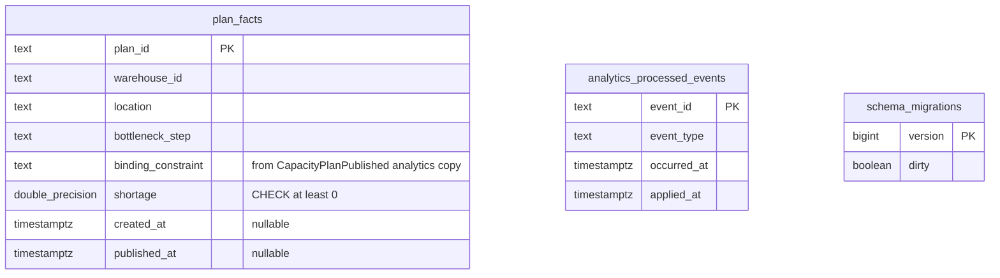

# Entity-relationship diagram

The final schemas after applying every migration in order. This service has
**two** Postgres databases:

- the **OLTP** database (`DATABASE_URL`), migrated by `cmd/api` and `cmd/mcp`
  from `internal/adapters/outbound/postgres/migrations/0001` to `0015`;
- the separate **analytical** database (`ANALYTICS_DATABASE_URL`,
  `warehouse_planning_analytics`), migrated and written only by
  `cmd/planning-projector` from `analytics/migrations/0001` (ADR 0005).

Both are migrated with golang-migrate (`postgres.RunMigrations`), which keeps
its own `schema_migrations` table in each database. There is no top-level
`migrations/` directory in this repository.

## OLTP database

```mermaid
erDiagram
  process_capacity ||--|{ process_capacity_constraint : "has, ON DELETE CASCADE"

  process_capacity {
    text process_type PK
    text location PK
    timestamptz window_start PK
    timestamptz window_end PK
    text native_unit
  }
  process_capacity_constraint {
    text process_type PK,FK
    text location PK,FK
    timestamptz window_start PK,FK
    timestamptz window_end PK,FK
    text constraint_type PK
    double_precision quantity
    double_precision period_seconds
    integer ordinal "registration order"
  }
  capacity_plans {
    text id PK "uuid string"
    text warehouse_id
    text location
    timestamptz window_start
    timestamptz window_end "CHECK end after start"
    text process_path_id "no FK"
    double_precision assigned_demand "CHECK at least 0"
    double_precision path_capacity "ORDER per HOUR"
    text bottleneck_step
    double_precision capacity_over_window
    double_precision shortage "CHECK at least 0"
    text status "DRAFT, PUBLISHED or SUPERSEDED"
    timestamptz created_at
    timestamptz published_at "nullable"
    text bottleneck_constraint "0005, default empty"
    text_array warnings "0005"
    text demand_source "0006/0016, request, orders or forecast"
    text forecast_path_id "0016, nullable; forecast source only"
    text scenario "0016, nullable, 1 to 64 characters"
    text superseded_by "0017, nullable, set iff SUPERSEDED"
    text site_id "0008, default empty; required for new plans"
    integer inbound_appointments "0009, dock-appointment demand the plan was created against"
    double_precision inbound_labour_minutes "0009"
    boolean inbound_standard_missing "0009"
    jsonb labour_requirement "0013, per step: standard_seconds, tasks, required_labour_hours, known, reason; default empty array"
  }
  process_flows {
    text flow_id PK
    text name
    jsonb stages "ordered: [{path_id, process_type}]"
    text status "ACTIVE | RETIRED"
    bigint version
    timestamptz updated_at
  }
  station_standards {
    text location PK
    text process_type PK
    double_precision quantity "CHECK above 0"
    text unit
    double_precision period_seconds "CHECK above 0"
    timestamptz updated_at
  }
  location_slot_registration {
    text location_code PK
    text zone_id
    text tally_type "LOCATION or STATION"
    text_array tally_keys
  }
  location_slot_tally {
    text zone_id PK
    text tally_type PK
    text tally_key PK
    integer count "floored at 0"
  }
  order_demand {
    text order_id PK
    text location "event site_id, else DEMAND_SITE_ID (0021)"
    timestamptz promise_at
    integer released_lines "CHECK at least 0"
    timestamptz as_of
  }
  inbound_appointments {
    text appointment_id PK "dock-scheduling's appointment id, 0009"
    text location "the events' site_id (0012; DEMAND_SITE_ID before)"
    text direction "INBOUND or OUTBOUND, nullable until a Booked or NoShow is seen, 0012"
    text status "BOOKED, CANCELLED or NO_SHOW; a terminal event arriving first is a tombstone"
    timestamptz window_start "nullable; set together with window_end; CHECK set when BOOKED"
    timestamptz window_end "nullable"
    integer asn_count "nullable; CHECK at least 0"
    bigint version "the producer's aggregate version, the ordering key, 0012; 0 for rows from the retired source"
    timestamptz as_of "newest producer event time written"
  }
  inbound_labour_standards {
    text location PK "0009"
    text process_path_id PK "no FK"
    double_precision minutes_per_appointment "CHECK above 0"
    double_precision minutes_per_asn "default 0, CHECK at least 0"
    timestamptz updated_at
  }
  observed_capacity {
    text location PK "DEMAND_SITE_ID, 0010"
    text process_type PK "the event's task_type, upper-cased"
    timestamptz bucket_start PK "event time truncated to the minute, UTC"
    bigint tasks_completed "CHECK above 0"
    bigint duration_seconds_total "default 0, CHECK at least 0"
    bigint tasks_with_duration "default 0, CHECK at least 0"
    timestamptz as_of
  }
  processed_events {
    text consumer PK
    text event_id PK
    timestamptz processed_at
  }
  labor_standards {
    text standard_id PK "labor-performance's id, 0013"
    text task_type "CHECK not empty"
    text handling_unit "empty = task-type-only, else EACH, CASE or PALLET"
    text site_code "empty = every site"
    bigint expected_seconds "CHECK above 0"
    bigint travel_component_seconds "nullable, CHECK at least 0"
    timestamptz effective_from
    timestamptz as_of "CloudEvents time"
  }
  workload_forecasts {
    text site_id PK "0014"
    text path_id PK
    jsonb buckets "cpt and quantity per bucket, at least one"
    timestamptz received_at
    bigint version "CHECK at least 1"
  }
  labour_plans {
    text site_id PK "0014"
    text shift_id PK
    text path_id PK "COLLATE C for keyset paging"
    integer planned_heads "CHECK at least 0 and at most installed_stations"
    double_precision rate_units_per_hour "CHECK above 0 and finite"
    double_precision hours "CHECK above 0 and finite"
    integer installed_stations "CHECK at least 0"
    timestamptz shift_start "nullable"
    text heads_source "request or forecast"
    bigint version "CHECK at least 1"
  }
  labour_plan_commitments {
    text site_id PK "0015"
    text shift_id PK
    text path_id PK "canonical: trimmed, upper case"
    integer committed_heads "CHECK at least 0"
    timestamptz observed_at "CloudEvents time of ShiftPlanCommitted"
    integer last_drift_heads "nullable until a drift was computed"
  }
  outbox_events {
    bigserial id PK
    text event_id UK "UNIQUE with topic, 0007"
    text topic UK
    text event_type "full CloudEvents type"
    text subject
    bytea key
    text dataschema
    bytea value "structured CloudEvent"
    jsonb headers "content-type plus traceparent, ADR 0014"
    timestamptz created_at
    timestamptz published_at "null until relayed"
    integer attempts "relay excludes the row at OUTBOX_MAX_ATTEMPTS, ADR 0013"
    text last_error
  }
  schema_migrations {
    bigint version PK
    boolean dirty
  }
```

Source: `internal/adapters/outbound/postgres/migrations/0001_process_capacity.up.sql`
through `0017_capacity_plan_superseded.up.sql`, `0018_process_flows.up.sql` (the `process_flows` copy of ADR 0025) and `0019_drop_process_paths.up.sql` (the local table gone, stage 3), `internal/adapters/outbound/postgres/migrate.go`.
Omits: the indexes (`idx_capacity_plans_warehouse_window`,
`idx_outbox_events_unpublished` partial on `published_at IS NULL`,
`idx_order_demand_location_promise`, `idx_inbound_appointments_location_window`
partial on `status = 'BOOKED'`, `idx_labor_standards_task_site_effective`
partial on `handling_unit = ''`) and column defaults. Types are drawn in
lower case with `_` instead of spaces (`double_precision`, `text_array` for
`TEXT[]`) because Mermaid types cannot contain spaces or brackets.

The **only** foreign key in the schema is
`process_capacity_constraint (process_type, location, window_start, window_end)`
referencing `process_capacity`, with `ON DELETE CASCADE`. Every other link is
logical and deliberately has no foreign key:

- `capacity_plans.process_path_id` names an ACTIVE `process_flows.flow_id`, but
  a plan stores its computed result and must survive the flow being revised or
  retired; the two are different aggregates.
- `capacity_plans.location` and the step `process_type`s line up with
  `process_capacity` rows only through window coverage at creation time; the
  plan never reads them again.
- `station_standards (location, process_type)` and `location_slot_tally`
  (zone ids starting with `<location>-`, `tally_key` = activity) are joined by a
  string prefix at read time (ADR 0002), not by a key.
- `location_slot_registration.(zone_id, tally_type, tally_keys)` remembers
  which `location_slot_tally` buckets a slot incremented, so a decommission
  knows what to decrement.
- `outbox_events.subject` and `key` are the raising aggregate's id: the
  capacity plan id, the ProcessCapacity identity, `<site_id>/<path_id>` for a
  workload forecast, `<site_id>/<shift_id>/<path_id>` for a labour plan and
  its drift.
- `processed_events.event_id` is the CloudEvents id of a consumed message;
  `consumer` is `labor-capacity-consumer`, `storage-capacity-consumer`,
  `order-demand-consumer`, `dock-appointment-consumer` (it was
  `inbound-demand-consumer`),
  `observed-capacity-consumer` or `labor-standard-consumer`.
- The three requirement-side tables of ADR 0023 share the key
  `(site_id, [shift_id,] path_id)` but have no foreign key between them:
  `labour_plans` reads `workload_forecasts` only when heads are derived (and
  keeps the number, not a reference), and `labour_plan_commitments` may hold a
  key no plan has yet (a commitment that arrived first) or a plan may have no
  commitment. Site and shift match exactly as sent; `path_id` is stored in its canonical
  form (trimmed, upper case) in all three tables, like the LABOR constraint's
  `ProcessType`.
- `labor_standards` holds facts, not a current value: the standard a plan uses
  is resolved at read time; `capacity_plans.labour_requirement` stores the
  result, so a later revision never rewrites a stored plan (ADR 0022).
- `inbound_appointments.appointment_id` names dock-scheduling's appointment
  (ADR 0017, source switched by ADR 0020); `location` is the `site_id` of its
  events. Rows written under the retired inbound-receiving source are INBOUND
  at version 0 and keep the site they were stored under until dock-scheduling
  next writes the appointment. `inbound_labour_standards.process_path_id` names a
  `process_paths.id` but is operator-declared and never defaulted, so it has
  no key. `observed_capacity` is fed by fulfillment-execution's
  `TaskCompleted` events and is advisory input only (ADR 0017); none of the
  three new tables has a foreign key.

## Analytical database

Source: `analytics/migrations/0001_plan_facts.up.sql`,
`internal/adapters/outbound/analyticsstore/postgres_projection.go`.
Omits: the partial indexes `idx_plan_facts_published_at` and
`idx_plan_facts_created_at`. There is no foreign key: `plan_facts.plan_id` is a
capacity plan id from the other database, and
`analytics_processed_events.event_id` is the CloudEvents id applied in the same
transaction as the `plan_facts` upsert.

## Table is not aggregate

| Table | Role | Aggregate / model |
| --- | --- | --- |
| `process_capacity` + `process_capacity_constraint` | Aggregate state (parent + child rows) | `ProcessCapacity` aggregate |
| `capacity_plans` | Aggregate state | `CapacityPlan` aggregate |
| `process_flows` | Event-fed copy of process-path-management's flows (ADR 0025; the `process_paths` table dropped with 0019) | `processflow.Flow` |
| `station_standards` | Stored value objects | `processcapacity.StationStandard` |
| `location_slot_tally`, `location_slot_registration` | Read model of facility-layout events | facility tally (`internal/application/tally`) |
| `order_demand` | Read model of order-management events | `demand.Order` |
| `inbound_appointments` | Read model of dock-scheduling's dock appointments (ADR 0017, ADR 0020) | inbound labour demand (`internal/application`) |
| `inbound_labour_standards` | Operator-declared labour standard per site and path (ADR 0017) | none (read at plan creation) |
| `observed_capacity` | Read model of fulfillment-execution's completed tasks (ADR 0017) | none (advisory variance input) |
| `labor_standards` | Local copy of labor-performance's engineered standards (ADR 0022) | `laborstandard.Standard` (resolved at read time) |
| `workload_forecasts` | Aggregate state (ADR 0023) | `WorkloadForecast` aggregate |
| `labour_plans` | Aggregate state (ADR 0023) | `LabourPlan` aggregate |
| `labour_plan_commitments` | Read model of workforce-management's committed heads, plus the last recorded drift (ADR 0023 decision 3) | `labourplan.Commitment` |
| `processed_events` | **Infrastructure**: consumer idempotency claims | none |
| `outbox_events` | **Infrastructure**: transactional outbox (two rows per domain event since `0007`) | none |
| `schema_migrations` | **Infrastructure**: golang-migrate bookkeeping | none |
| `plan_facts` | **Analytics projection** (separate database) | none (derived from the analytics stream) |
| `analytics_processed_events` | **Infrastructure / analytics**: projector idempotency | none |

The `idempotency_keys` table (migration `0011_idempotency_keys`, ADR 0019)
holds the fleet `Idempotency-Key` answers of the four REST POSTs; the key row
commits in the same unit of work as the aggregate change and the outbox rows.
