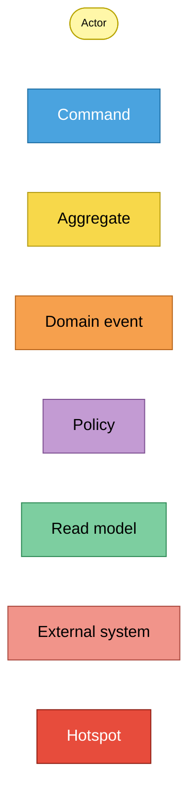
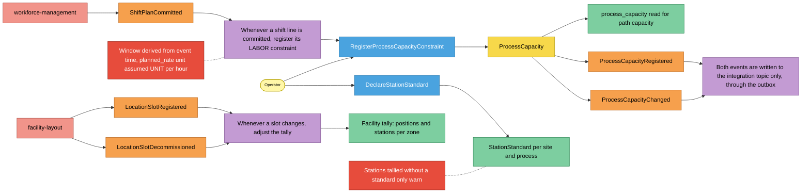
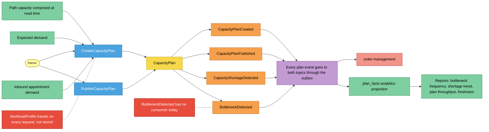
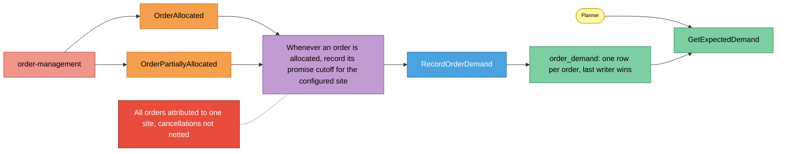
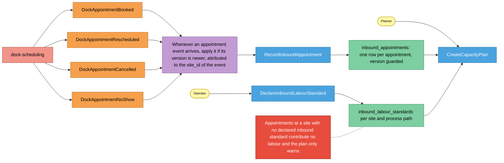
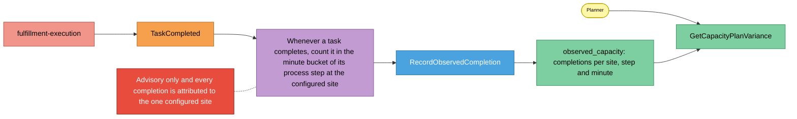

# EventStorming (design level)

Notation from the ddd-crew
[EventStorming glossary and cheat sheet](https://github.com/ddd-crew/eventstorming-glossary-cheat-sheet).
Five processes, each read left to right. Hotspots are real, documented gaps
(ADRs, code comments), not invented ones.

## Legend

Source: ddd-crew cheat-sheet colours as specified for the fleet.
Omits: nothing; this is the key for the five diagrams below.

## 1. Capacity facts arrive from upstream

Source: `internal/adapters/inbound/kafka/labor_capacity_consumer.go`,
`storage_capacity_consumer.go`,
`internal/application/usecases/register_process_capacity_constraint.go`,
`declare_station_standard.go`, `internal/domain/processcapacity/*.go`
(`events.go`).
Omits: the processed-event claim and DLQ mechanics (see the
[sequence diagrams](/docs/ddd/sequence-diagrams)) and `RegisterProcessPath`,
which the operator also issues before planning. `ProcessCapacity` raises
`ProcessCapacityRegistered` when its first constraint is registered and
`ProcessCapacityChanged` when a registration moves the effective rate; a
registration that leaves the rate untouched raises nothing. Neither event has
a consumer yet (see [Domain events](/docs/ddd/domain-events)), and the
analytics fanout carries plan facts only (`apis/asyncapi.yaml`, ADR 0005).

## 2. Plan, publish, announce the shortage

Source: `internal/application/usecases/create_capacity_plan.go`,
`publish_capacity_plan.go`, `inbound_demand.go`, `internal/domain/capacityplan/*.go`,
`internal/adapters/outbound/kafka/analytics_encoder.go` (`FanoutEncoder`),
`internal/adapters/outbound/analyticsstore/postgres_projection.go`,
`internal/adapters/inbound/http/reports_handler.go`.
Omits: the rejection paths (`ErrAlreadyPublished`, `ErrMissingAssignedDemand`,
`ErrMissingStepCapacity`). `CapacityShortageDetected` and `BottleneckDetected`
are raised only when `shortage > 0`.

## 3. Expected demand from order-management

Source: `internal/adapters/inbound/kafka/order_demand_consumer.go`,
`internal/application/usecases/expected_demand.go`,
`internal/domain/demand/order.go`, ADR 0004.
Omits: `OrderRepromised` (deliberately ignored: no new cutoff instant) and the
required `DEMAND_CONSUMER_GROUP` / `DEMAND_SITE_ID` configuration.

## 4. Inbound demand from dock-scheduling

Source: `internal/adapters/inbound/kafka/dock_appointment_consumer.go`,
`internal/application/usecases/inbound_demand.go`
(`RecordInboundAppointment`, `DeclareInboundLabourStandard`,
`GetInboundDemand`), `create_capacity_plan.go` (`resolveInbound`), ADR 0017
and ADR 0020.
Omits: the processed-event claim and DLQ mechanics, and the retired source
(inbound-receiving's appointment events are no longer consumed, ADR 0020).

## 5. Observed capacity from fulfillment-execution

Source: `internal/adapters/inbound/kafka/observed_capacity_consumer.go`,
`internal/application/usecases/observed_capacity.go`
(`RecordObservedCompletion`, `GetCapacityPlanVariance`), ADR 0017.
Omits: the processed-event claim and DLQ mechanics and the required
`OBSERVED_CAPACITY_CONSUMER_GROUP` / `DEMAND_SITE_ID` configuration. The
variance never changes a planned capacity.

## Sticky inventory

| Sticky | Kind | Code evidence |
| --- | --- | --- |
| Operator, Planner | Actor | REST callers (`warehouse-console` remote `web/src/api.ts`) and MCP clients |
| `RegisterProcessCapacityConstraint` | Command | `internal/application/usecases/register_process_capacity_constraint.go` |
| `DeclareStationStandard` | Command | `internal/application/usecases/declare_station_standard.go` |
| `CreateCapacityPlan` | Command | `internal/application/usecases/create_capacity_plan.go` |
| `PublishCapacityPlan` | Command | `internal/application/usecases/publish_capacity_plan.go` |
| `RecordOrderDemand` | Command | `internal/application/usecases/expected_demand.go` |
| `RecordInboundAppointment`, `DeclareInboundLabourStandard` | Command | `internal/application/usecases/inbound_demand.go` |
| `RecordObservedCompletion` | Command | `internal/application/usecases/observed_capacity.go` |
| `ProcessCapacity` | Aggregate | `internal/domain/processcapacity/process_capacity.go` |
| `CapacityPlan` | Aggregate | `internal/domain/capacityplan/capacity_plan.go` |
| `CapacityPlanCreated`, `CapacityPlanPublished`, `CapacityShortageDetected`, `BottleneckDetected` | Domain event (published) | `internal/domain/capacityplan/events.go`, `internal/adapters/outbound/kafka/encoder.go` |
| `ProcessCapacityRegistered`, `ProcessCapacityChanged` | Domain event (published, integration topic only) | `internal/domain/processcapacity/events.go`, `register_process_capacity_constraint.go` |
| `ShiftPlanCommitted` | Domain event (consumed) | `typeShiftPlanCommitted` in `labor_capacity_consumer.go` |
| `LocationSlotRegistered`, `LocationSlotDecommissioned` | Domain event (consumed) | `typeLocationSlotRegistered`, `typeLocationSlotDecommissioned` in `storage_capacity_consumer.go` |
| `OrderAllocated`, `OrderPartiallyAllocated` | Domain event (consumed) | `typeOrderAllocated`, `typeOrderPartiallyAllocated` in `order_demand_consumer.go` |
| `DockAppointmentBooked`, `DockAppointmentRescheduled`, `DockAppointmentCancelled`, `DockAppointmentNoShow` | Domain event (consumed) | `typeDockAppointment*` in `dock_appointment_consumer.go` |
| `TaskCompleted` | Domain event (consumed) | `typeTaskCompleted` in `observed_capacity_consumer.go` |
| Register LABOR on shift commit | Policy | `LaborCapacityConsumer.HandleMessage` |
| Adjust the tally on slot change | Policy | `StorageCapacityConsumer.handleRegistered` / `handleDecommissioned` |
| Record order demand | Policy | `OrderDemandConsumer.HandleMessage` |
| Apply a dock appointment event, version guarded | Policy | `DockAppointmentConsumer.HandleMessage` |
| Count a completed task in its minute bucket | Policy | `ObservedCapacityConsumer.HandleMessage` |
| Fan out to both topics through the outbox | Policy | `FanoutEncoder.Encode`, `enqueue` in `create_capacity_plan.go` |
| Path capacity, facility tally, StationStandard, expected demand, inbound demand, observed capacity and variance, `plan_facts`, reports | Read model | `GetProcessPathCapacity`, `location_slot_tally`, `station_standards`, `order_demand`, `inbound_appointments`, `inbound_labour_standards`, `observed_capacity`, `plan_facts`, `internal/analytics/report` |
| workforce-management, facility-layout, order-management, dock-scheduling, fulfillment-execution | External system | the five consumer files above (`labor_capacity_consumer.go`, `storage_capacity_consumer.go`, `order_demand_consumer.go`, `dock_appointment_consumer.go`, `observed_capacity_consumer.go`) and order-management's `planned_capacity_consumer.go` |
| Derived labor window, assumed UNIT/HOUR | Hotspot | ADR 0001 Addendum; `laborRateUnit` comment in `labor_capacity_consumer.go` |
| Stations without a standard only warn | Hotspot | `ComposeStepCapacity` warning, ADR 0002 |
| WorkloadProfile not stored | Hotspot | `GetProcessPathCapacityCommand` doc comment ("PHASE 2 SIMPLIFICATION") |
| BottleneckDetected without a consumer | Hotspot | order-management's `planned_capacity_consumer.go` ignores it |
| One site, no cancellation netting | Hotspot | ADR 0004, `cmd/api/runtime.go` |
| No inbound standard declared, appointments price at zero | Hotspot | `resolveInbound` in `create_capacity_plan.go` |
| Observed capacity is advisory and single-site | Hotspot | `observed_capacity_consumer.go`, ADR 0017 |
