# Sequence diagrams

UML sequence diagrams of every command use case, derived from the use-case
bodies in `internal/application/usecases`, the inbound adapters and the
Postgres adapters. REST and MCP call the **same** use cases; where both exist
the diagram shows REST and names the MCP tool. The four REST POSTs sit behind
the `Idempotency-Key` middleware (ADR 0019; the diagrams below omit it: the key
row, the aggregate change and the outbox rows commit in one unit of work). The
capacity aggregates have **no** optimistic version column: concurrent publishes
serialize on a row lock instead. The requirement-side `PUT`s (ADR 0023, sections
10 and 11) take no Idempotency-Key and use a `version` column instead.

## 1. Register a process capacity constraint (REST / MCP)

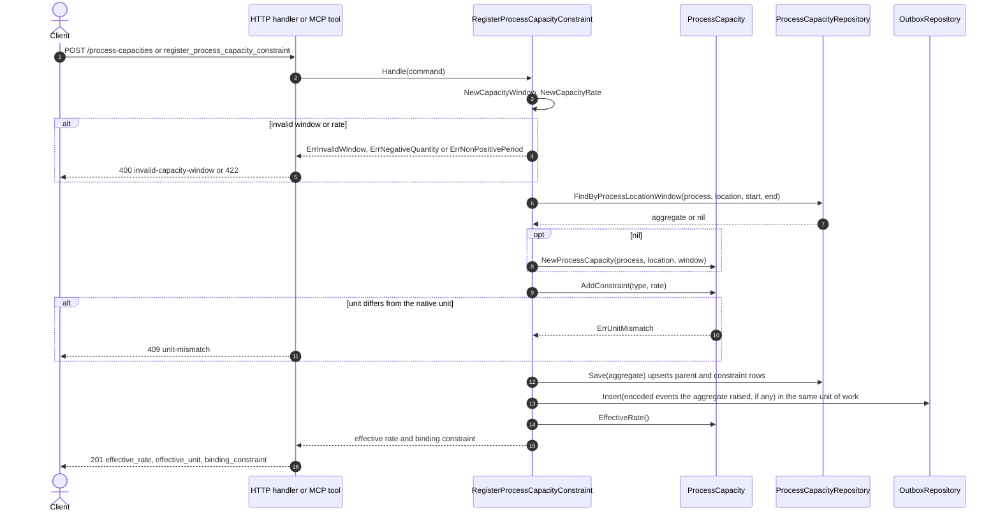

Source: `internal/application/usecases/register_process_capacity_constraint.go`,
`internal/adapters/inbound/http/process_capacity_handler.go`,
`internal/adapters/inbound/mcp/tools.go`,
`internal/adapters/outbound/postgres/process_capacity_repository.go`.
Omits: JSON decoding errors (`400 malformed-json`) and the MCP-only
`non-positive-period` check of `period_seconds` before the use case. The
aggregate raises `ProcessCapacityRegistered` (first constraint) or
`ProcessCapacityChanged` (effective rate moved), and nothing otherwise. In
`cmd/api` and `cmd/mcp` the use case is wired with the outbox, the encoder and
the unit of work, so the save and the outbox rows commit or roll back as one
(`cmd/api/main.go`); a use case built without them saves and publishes
nothing.

## 2. Labor capacity from ShiftPlanCommitted (Kafka)

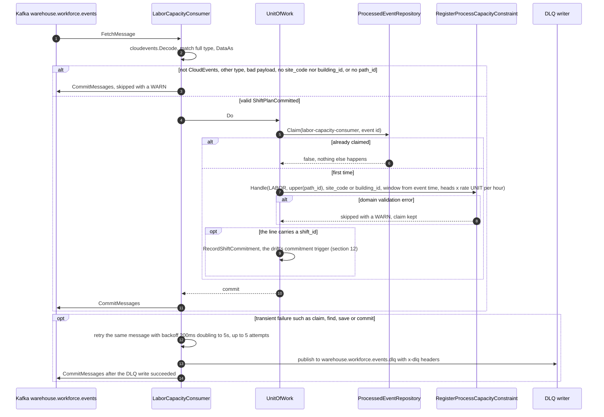

Source: `internal/adapters/inbound/kafka/labor_capacity_consumer.go`,
`kafka.go` (`consumeLoop`), `deadletter.go`,
`internal/adapters/outbound/postgres/unit_of_work.go`, `processed_event_repository.go`.
Omits: the commit retry loop (an offset commit that fails is retried until it
succeeds) and logging.

## 3. Facility tally from LocationSlotRegistered / Decommissioned (Kafka)

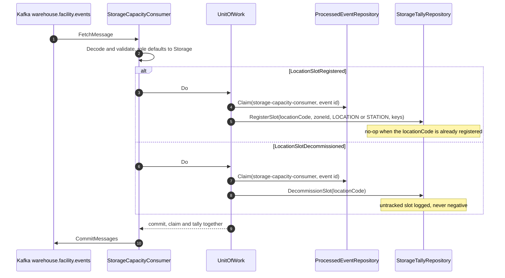

Source: `internal/adapters/inbound/kafka/storage_capacity_consumer.go`,
`internal/adapters/outbound/postgres/storage_tally_repository.go`.
Omits: the skip branches (not CloudEvents, unknown type, missing fields,
unknown role), the duplicate-claim branch and the retry-then-DLQ path to
`warehouse.facility.events.dlq`, all identical to diagram 2. No use case and no
`ProcessCapacity` are involved.

## 4. Expected demand from OrderAllocated (Kafka)

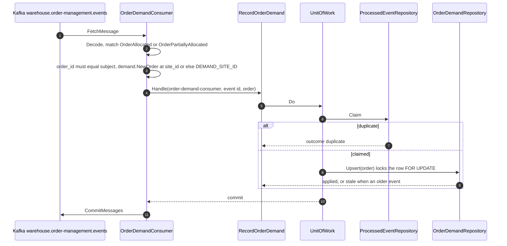

Source: `internal/adapters/inbound/kafka/order_demand_consumer.go`,
`internal/application/usecases/expected_demand.go` (`RecordOrderDemand`),
`internal/adapters/outbound/postgres/order_demand_repository.go`,
`internal/domain/demand/order.go`, `cmd/api/runtime.go`.
Omits: the skip branches and the retry-then-DLQ path to
`warehouse.order-management.events.dlq` (as diagram 2). The consumer is always
on: `DEMAND_CONSUMER_GROUP` and `DEMAND_SITE_ID` are required at boot.

## 5. Register a process path and declare a station standard (REST / MCP)

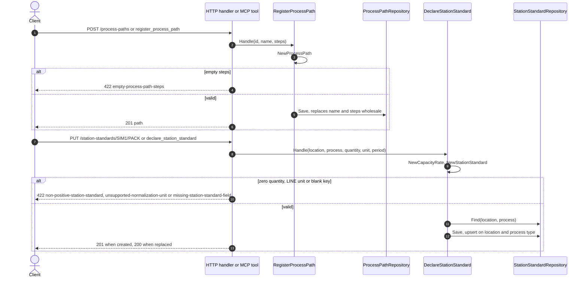

Source: `internal/application/usecases/register_process_path.go`,
`declare_station_standard.go`, `internal/adapters/inbound/http/process_path_handler.go`,
`station_handler.go`, `internal/domain/processpath/process_path.go`,
`internal/domain/processcapacity/station_standard.go`.
Omits: JSON decoding errors and the MCP result shapes.

## 6. Create a capacity plan (REST / MCP)

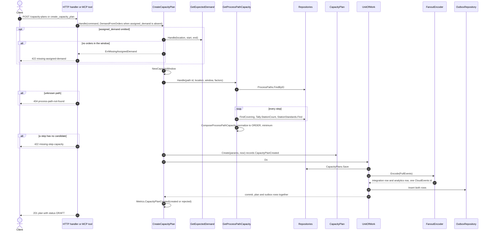

Source: `internal/application/usecases/create_capacity_plan.go`,
`get_process_path_capacity.go`, `expected_demand.go`,
`internal/domain/processcapacity/process_path_capacity.go`, `step_capacity.go`,
`internal/domain/capacityplan/capacity_plan.go`,
`internal/adapters/outbound/kafka/analytics_encoder.go`,
`internal/adapters/inbound/http/capacity_plan_handler.go`.
Omits: the WorkloadProfile errors (`422` factor slugs), `ErrNegativeDemand`,
`ErrRequiredField` and malformed-timestamp `400`s. The metric is recorded for
both outcomes.

## 7. Publish a capacity plan (REST / MCP)

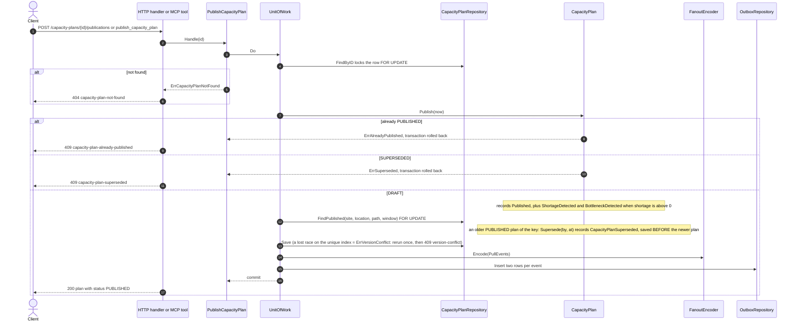

Source: `internal/application/usecases/publish_capacity_plan.go`,
`internal/adapters/outbound/postgres/capacity_plan_repository.go`,
`internal/domain/capacityplan/capacity_plan.go`.
Omits: the in-memory test doubles (no row lock; the memory unit of work rolls
participants back on error), which no shipped binary uses.

## 8. Outbox relay to Kafka

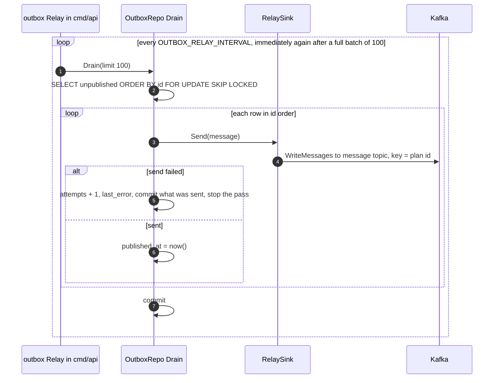

Source: `internal/adapters/outbound/outbox/relay.go`,
`internal/adapters/outbound/postgres/outbox_repository.go`,
`internal/adapters/outbound/kafka/relay_sink.go`, `cmd/api/main.go`
(`startOutboxRelay`).
Omits: the lazy first dial of the Kafka writer (and the one-off
`Unknown Topic Or Partition` on the first write to an output topic that does not
exist yet). The log sink is gone ([ADR 0016](/docs/adr/0016-postgres-and-kafka-are-the-only-runtime)).

## 9. Analytics projection (cmd/planning-projector)

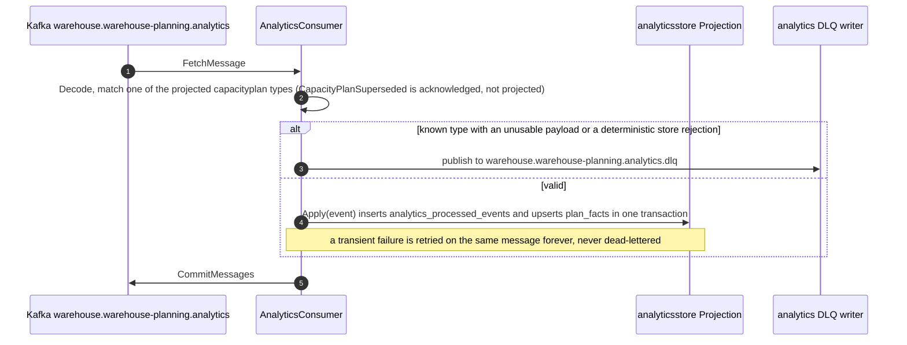

Source: `internal/adapters/inbound/kafka/analytics_consumer.go`,
`internal/adapters/outbound/analyticsstore/postgres_projection.go`,
`cmd/planning-projector/main.go`, ADR 0005.
Omits: not-CloudEvents and other-type messages (skipped with a rate-limited
WARN) and the read side (`cmd/planning-reports`), which only queries. The three
requirement-side types (ADR 0023) reach this consumer too and are acknowledged
without being projected.

## 10. Planner's morning, step 1: receive the workload forecast (REST)

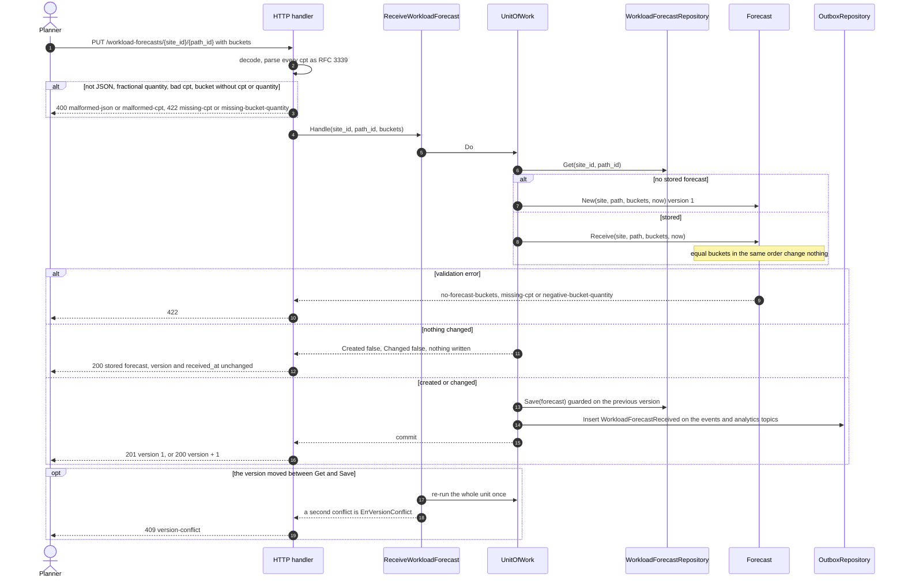

Source: `internal/adapters/inbound/http/workload_forecast_handler.go`,
`internal/application/usecases/workload_forecast.go`,
`internal/domain/workloadforecast/forecast.go`,
`internal/adapters/outbound/postgres/workload_forecast_repository.go`.
Omits: the read (`GET /workload-forecasts/{site_id}/{path_id}`, a plain
`Get`, `404 workload-forecast-not-found`) and the relay hop to Kafka.

## 11. Planner's morning, step 2: commit the labour plan (REST, drift trigger B)

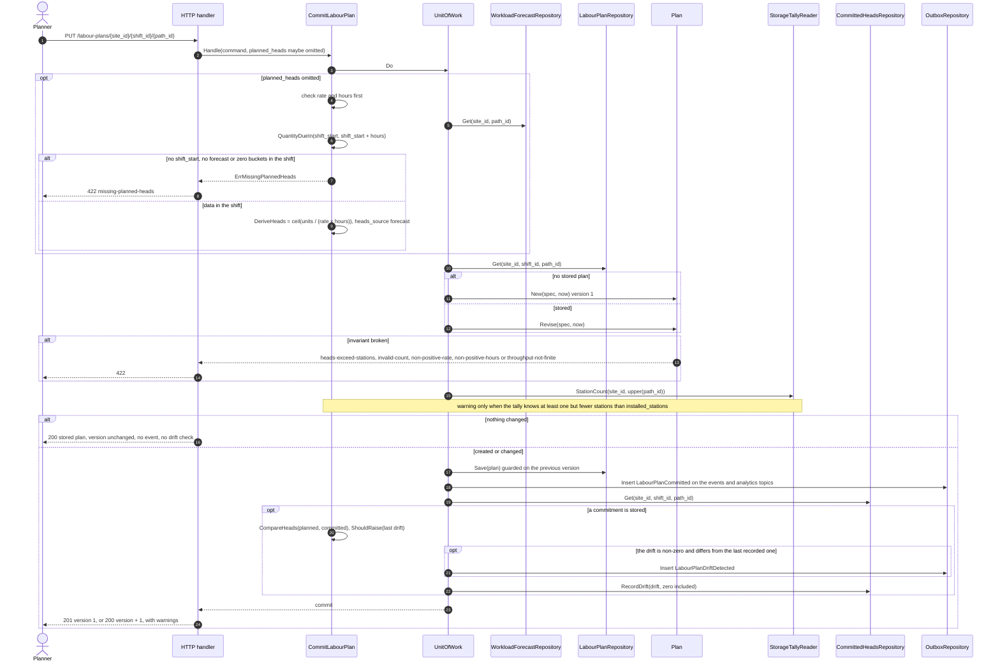

Source: `internal/adapters/inbound/http/labour_plan_handler.go`,
`internal/application/usecases/labour_plan.go` (`spec`, `deriveHeads`,
`stationWarnings`), `labour_plan_drift.go` (`surfaceDrift`, `driftRecorder`),
`internal/domain/labourplan/plan.go`, `drift.go`, `cmd/api/requirement.go`.
Omits: the `409 version-conflict` path (as in section 10), the `400` decoding
errors (`malformed-json`, `malformed-shift-start`) and the reads
(`GET /labour-plans/...`, which recompute the warning on every call).

## 12. Labour plan drift, trigger A: a ShiftPlanCommitted line (Kafka)

The second step of the labor consumer's unit of work (section 2), after the
LABOR registration, whatever that registration decided.

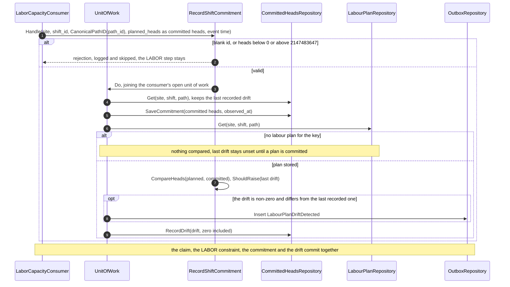

Source: `internal/adapters/inbound/kafka/labor_capacity_consumer.go`
(`recordCommitment`), `internal/application/usecases/labour_plan_drift.go`,
`internal/domain/labourplan/drift.go`, `commitment.go`,
`internal/adapters/outbound/postgres/committed_heads_repository.go`.
Omits: a line without `shift_id` (it records nothing here) and a redelivered
event (its claim fails first, so nothing runs). Accepted limits: there is no
stale-event guard on `observed_at` (per-key Kafka order is relied on), and if
the very first commitment and the very first plan of a key commit at the same
instant, neither trigger sees the other and one drift can go unraised until
the next change.
