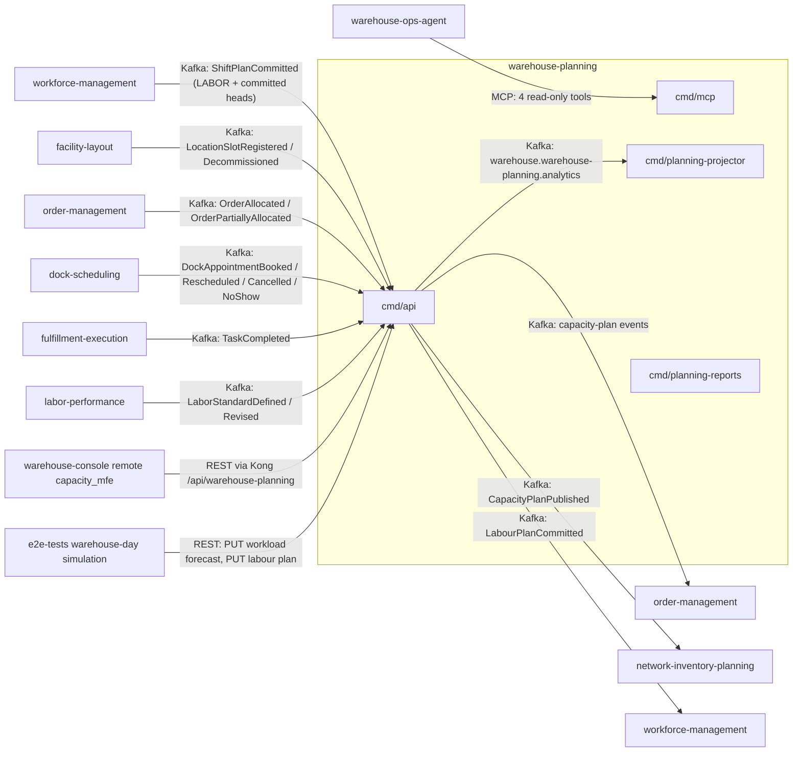

# Upstream and downstream contracts

Every edge between `warehouse-planning` and the rest of the fleet: which
protocol, which contract, and what happens when it fails. The consumed event
shapes were confirmed against each producer's own `apis/asyncapi.yaml` (see
the Addendum of
[ADR 0001](/docs/adr/0001-warehouse-planning-bounded-context)) rather than
guessed.

## At a glance

Source: `cmd/api/main.go`, `cmd/api/runtime.go`, `cmd/api/requirement.go`, `cmd/mcp/main.go`,
`cmd/planning-projector/main.go`, `internal/adapters/inbound/kafka/*_consumer.go`,
`internal/adapters/outbound/kafka/encoder.go`, `web/src/api.ts`; on the sibling side
workforce-management `cmd/workforce/labour_plan.go` and e2e-tests `cmd/warehouse-day/sim.go`.
Omits: the DLQ topics, Postgres and the OTel Collector. workforce-management is drawn
twice only to keep the upstream and downstream edges readable.

| Direction | Counterpart | Protocol | Contract | Failure behaviour |
| --- | --- | --- | --- | --- |
| upstream | `workforce-management` | Kafka, `warehouse.workforce.events` | `com.warehouse.wes.workforce-management.shiftplan.ShiftPlanCommitted` (the LABOR constraint, and the committed heads of the labour plan drift, ADR 0023) | transient errors retried 5 times, then `warehouse.workforce.events.dlq` |
| upstream | `facility-layout` | Kafka, `warehouse.facility.events` | `...facility-layout.locationslot.LocationSlotRegistered`, `...LocationSlotDecommissioned` | same, `warehouse.facility.events.dlq` |
| upstream | `order-management` | Kafka, `warehouse.order-management.events` | `...order-management.order.OrderAllocated`, `...OrderPartiallyAllocated` | same, `warehouse.order-management.events.dlq`; consumer always on |
| upstream | `dock-scheduling` | Kafka, `warehouse.dock-scheduling.events` | `...dock-scheduling.dockappointment.DockAppointmentBooked`, `...DockAppointmentRescheduled`, `...DockAppointmentCancelled`, `...DockAppointmentNoShow` | transient: retried 5 times; deterministic: dead-lettered at once; `warehouse.dock-scheduling.events.dlq`; consumer always on |
| upstream | `fulfillment-execution` | Kafka, `warehouse.fulfillment.events` | `...fulfillment-execution.task.TaskCompleted` | same, `warehouse.fulfillment.events.dlq`; consumer always on |
| upstream | `labor-performance` | Kafka, `warehouse.labor-performance.events` (its integration topic) | `...labor-performance.standard.LaborStandardDefined`, `...LaborStandardRevised` (ADR 0022) | a deterministic failure goes to `warehouse.labor-performance.events.dlq` at once; transient errors retried 5 times, then the same DLQ; every other type ignored; consumer always on |
| inbound caller | `warehouse-console` (remote `capacity_mfe` from `web/`) | REST through Kong at `/api/warehouse-planning` | `apis/openapi.yaml` ([API reference](/docs/api-reference)) | RFC 7807 problem responses (`application/problem+json`); the call fails, nothing is retried by this service |
| inbound caller | `warehouse-ops-agent` | MCP (Streamable HTTP, `cmd/mcp` on `:8090`) | `get_process_path_capacity`, `get_capacity_plan`, `get_storage_capacity`, `list_station_standards` ([MCP tools](/docs/mcp/tools)) | the tool returns an error result; how the agent degrades is that repo's concern |
| inbound caller | planners; today the `e2e-tests` warehouse-day simulation (`cmd/warehouse-day/sim.go`) | REST `PUT /workload-forecasts/{site_id}/{path_id}`, `PUT /labour-plans/{site_id}/{shift_id}/{path_id}` and their reads (ADR 0023; REST only, no MCP tool or A2A skill) | `apis/openapi.yaml` | RFC 7807; the `PUT`s are idempotent, so a caller retries the same body safely |
| downstream | `order-management` | Kafka, `warehouse.warehouse-planning.events` | the four `com.warehouse.wes.warehouse-planning.capacityplan.*` types ([event catalogue](/docs/api-reference/events)) | outbox: the row stays unpublished and is retried every relay pass |
| downstream | `network-inventory-planning` | Kafka, `warehouse.warehouse-planning.events` | `...capacityplan.CapacityPlanPublished` (with `site_id`, ADR 0012) | outbox as above |
| downstream | `workforce-management` | Kafka, `warehouse.warehouse-planning.events` | `com.warehouse.wes.warehouse-planning.labourplan.LabourPlanCommitted` (its ADR 0043, group `workforce-management-labour-plans`) | outbox as above; it applies a message only when `version` is greater than its stored one |
| internal | `cmd/planning-projector` | Kafka, `warehouse.warehouse-planning.analytics` | the four plan types are projected ([ADR 0005](/docs/adr/0005-analytics-read-side)); the three requirement-side types are acknowledged and not projected | outbox as above; projector DLQ `warehouse.warehouse-planning.analytics.dlq` |

There are **no outbound REST or MCP calls**: no adapter under
`internal/adapters/outbound` opens an HTTP client to a sibling context. Every
fact this context needs from another context arrives as a Kafka event.

## Envelope

Every message in both directions is a CloudEvents 1.0 event in **structured
mode**: the whole envelope is the Kafka value and the `content-type` header is
`application/cloudevents+json; charset=UTF-8`
(`internal/adapters/kafka/cloudevents/cloudevents.go`). Consumers match on the
**full** CloudEvents `type`; unknown types on a topic are ignored. A message
that is not a valid CloudEvent (including the retired flat envelope) is
logged and skipped.

## Upstream: workforce-management

| | |
| --- | --- |
| Type | `com.warehouse.wes.workforce-management.shiftplan.ShiftPlanCommitted` |
| Topic | `warehouse.workforce.events` |
| Consumer group | `LABOR_CAPACITY_CONSUMER_GROUP` (default `warehouse-planning-labor-capacity`) |
| Fan-out | one message per PathPlan line of a committed ShiftPlan |
| Fields used | `site_code` (else the deprecated `building_id`), `path_id`, `planned_heads`, `planned_rate`, `planned_hours`, `shift_id` |
| Effect | a `LABOR` constraint on the ProcessCapacity of ProcessType = upper-case(`path_id`) at Location = `site_code`, or `building_id` when `site_code` is absent ([ADR 0021](/docs/adr/0021-order-demand-and-labour-read-the-events-own-site)); then, in the same unit of work and only for a line with a `shift_id`, the committed heads of `(site, shift_id, path_id)` in `labour_plan_commitments` and the labour plan drift against the stored labour plan ([ADR 0023](/docs/adr/0023-workload-forecast-and-labour-plan-move-here) decision 3) |
| Rate | `planned_heads * planned_rate`, registered as `UNIT/HOUR` (a documented default; the native unit of `planned_rate` is not specified upstream) |
| Window | `[event.time, event.time + planned_hours)` (a documented assumption: no real shift-start field exists upstream yet) |

This is the **only** thing the consumers register as a ProcessCapacity
constraint. The drift step keeps `path_id` as sent (trimmed); only the LABOR
step upper-cases it. It never changes the labour plan, and the commitment is
recorded whatever the LABOR registration decided (a line the LABOR step
skips as invalid still records its heads). There is no stale-event guard on
the event `time`: the per-key order of the producer's topic is relied on.

## Upstream: facility-layout

| | |
| --- | --- |
| Types | `com.warehouse.wms.facility-layout.locationslot.LocationSlotRegistered` and `...LocationSlotDecommissioned` |
| Topic | `warehouse.facility.events` |
| Consumer group | `STORAGE_CAPACITY_CONSUMER_GROUP` (default `warehouse-planning-storage-capacity`) |
| Fields used | `locationCode`, `zoneId`, `locationType`, `role` (default `Storage`), `activities` (present only when `role=WorkCenter`) |
| Effect | maintains a tally: storage positions per `(zoneId, locationType)` for `role=Storage`, stations per zone and activity for `role=WorkCenter`; decommissioning decrements the same tally |

The facility consumer is a pure tally maintainer: it registers no
ProcessCapacity, no sentinel process type and no fake unit. Station counts
become capacity only at read time, composed with an operator-declared
StationStandard
([capacity composition](/docs/overview/capacity-composition)).

## Upstream: order-management

[ADR 0004](/docs/adr/0004-demand-ingestion-from-order-management). The
consumer is always on ([ADR 0016](/docs/adr/0016-postgres-and-kafka-are-the-only-runtime)
removed the off switch): `DEMAND_CONSUMER_GROUP` and `DEMAND_SITE_ID` are
required and the binary exits at boot, naming the variable, without either.

| | |
| --- | --- |
| Types | `com.warehouse.wes.order-management.order.OrderAllocated` and `com.warehouse.wes.order-management.order.OrderPartiallyAllocated` |
| Topic | `warehouse.order-management.events` |
| Consumer group | `DEMAND_CONSUMER_GROUP` (required, no default) |
| Fields used | `order_id` (must equal the CloudEvents `subject`), `promise_date`, `len(lines)`, and the CloudEvents `time` |
| Effect | upserts one `order_demand` row per order id (last writer wins on `time`); an order is attributed to the event's optional `site_id` (order-management ADR 0050), or to the fallback site `DEMAND_SITE_ID` when it carries none ([ADR 0021](/docs/adr/0021-order-demand-and-labour-read-the-events-own-site)) |
| Ignored | `OrderRepromised` (no new cutoff instant) and every other type on the topic |

Demand is therefore counted in orders (no units) and not netted for
cancellations. It is read by `GET /demand`, the `get_expected_demand` MCP tool
and `POST /capacity-plans` when `assigned_demand` is omitted.

## Upstream: dock-scheduling

[ADR 0017](/docs/adr/0017-inbound-labour-demand-and-observed-capacity-feedback) defined the inbound demand; [ADR 0020](/docs/adr/0020-inbound-demand-from-dock-scheduling) moved its source from inbound-receiving to dock-scheduling, the owner of door time. Always on; `DOCK_APPOINTMENT_CONSUMER_GROUP` is required and the binary exits at boot, naming it, without it. The old `INBOUND_DEMAND_CONSUMER_GROUP` is refused at boot (a stale deployment fails loudly instead of reading an unused topic).

| | |
| --- | --- |
| Types | `com.warehouse.wms.dock-scheduling.dockappointment.DockAppointmentBooked`, `...DockAppointmentRescheduled`, `...DockAppointmentCancelled` and `...DockAppointmentNoShow` |
| Topic | `warehouse.dock-scheduling.events` |
| Consumer group | `DOCK_APPOINTMENT_CONSUMER_GROUP` (required, no default) |
| Fields used | `appointment_id` (must equal the CloudEvents `subject`), `site_id`, `direction` (Booked, NoShow), `window_start`, `window_end` (Booked, Rescheduled), `len(asn_numbers)` (Booked) and `version` (the ordering guard) |
| Effect | stores one `inbound_appointments` row per appointment id at the event's `site_id`; only INBOUND appointments are demand; Rescheduled moves the window, Cancelled and NoShow remove it; the state changes only when `version` is greater than the stored one, and the booking facts (direction, ASN count) are filled in whenever they arrive, so the arrival order never matters |
| Ignored | every other type on the topic (door calendar events) and the retired `...inbound-receiving.dockappointment.*` types |

The event carries no labour: the minutes per appointment (and per ASN) are an operator-declared standard owned by this context (`PUT /inbound-labour-standards/{location}/{path_id}`). Without one an appointment is recorded but contributes no demand and the plan warns `inbound standard missing`. Read by `GET /inbound-demand`, the `get_inbound_demand` MCP tool and `POST /capacity-plans`.

## Upstream: fulfillment-execution

[ADR 0017](/docs/adr/0017-inbound-labour-demand-and-observed-capacity-feedback). Always on; `OBSERVED_CAPACITY_CONSUMER_GROUP` is required.

| | |
| --- | --- |
| Type | `com.warehouse.wes.fulfillment-execution.task.TaskCompleted` |
| Topic | `warehouse.fulfillment.events` |
| Consumer group | `OBSERVED_CAPACITY_CONSUMER_GROUP` (required, no default) |
| Fields used | `task_id` (must equal the CloudEvents `subject`), `task_type`, `duration_seconds` (optional) and the CloudEvents `time` |
| Effect | adds the completion to the `observed_capacity` minute bucket of (`DEMAND_SITE_ID`, upper-cased `task_type`); a redelivered `id` adds nothing |
| Ignored | every other type on the topic |

Observed throughput is in tasks, not orders. It is read only by the advisory `GET /capacity-plans/{id}/variance` (and MCP `get_capacity_plan_variance`), which needs a caller-supplied `tasks_per_order` and never changes a plan or a planned capacity.

## Upstream: process-path-management

[ADR 0025](/docs/adr/0025-process-flows-from-process-path-management) stage 1 (producer side: process-path-management ADR 0042, the `ProcessFlow` aggregate: an ordered list of `path_id` + `process_type` stages). Always on; `PROCESS_FLOW_CONSUMER_GROUP` is required (chart `processFlow.consumerGroup`, warehouse-infra pin `warehouse-planning-process-flows`).

| | |
|---|---|
| Topic | `warehouse.process-path-management.events` (key and subject = `flow_id`) |
| Types | `com.warehouse.wes.process-path-management.processflow.ProcessFlowDefined` / `ProcessFlowRevised` / `ProcessFlowRetired` — each the FULL state: `flow_id`, `name`, `stages` (`[{path_id, process_type}]` in order), `status` ACTIVE\|RETIRED, `version` |
| Copy | `process_flows` (migration 0018): one row per flow id, stages and version |
| Apply rule | only when `version` is greater than the stored one (equal or lower = no-op, so the producer's startup republish and reordering are harmless); claim and apply in ONE unit of work |
| Poison | unknown `process_type`, no stages, bad `status` or `version` -> DLQ `warehouse.process-path-management.events.dlq`, never retried, counted `rejected` (`warehouse_planning.process_flows.messages{outcome=...}`) |
| Effect on reads | path capacity resolves an ACTIVE flow with the id first (`source: flow`), else the locally declared path (`source: local`); a RETIRED flow does not resolve |
| Ignored | every other type on the topic (`ProcessPath*`, `CPTScheduleChanged`) |

## Upstream: labor-performance

[ADR 0022](/docs/adr/0022-labour-standards-from-labor-performance) (producer side: labor-performance ADR 0038, which put both types on its integration topic). Always on; `LABOR_STANDARD_CONSUMER_GROUP` is required.

| | |
| --- | --- |
| Types | `com.warehouse.wes.labor-performance.standard.LaborStandardDefined` and `...LaborStandardRevised` |
| Topic | `warehouse.labor-performance.events` (never its analytics topic: that belongs to its own projector) |
| Consumer group | `LABOR_STANDARD_CONSUMER_GROUP` (chart default and warehouse-infra pin `warehouse-planning-labor-standards`) |
| Fields used | `standard_id`, `task_type`, `expected_seconds` (> 0), `effective_from` (required); `travel_component_seconds`, `handling_unit` (`EACH`, `CASE`, `PALLET`), `site_code` (optional); the CloudEvents `time` as `as_of` |
| Effect | one immutable `labor_standards` row per `standard_id` (a known id changes nothing); the standard in force for a plan's site, task type and window start is resolved at read time (site-scoped over fleet-wide, then the latest `effective_from`, then the latest `as_of`) |
| Ignored | every other type on the topic; `previous_expected_seconds` and the team-lift fields |

A message missing a required field, or with `expected_seconds <= 0`, is
dead-lettered at once (a retry cannot fix it). The copy prices the labour
requirement of a capacity plan (`PICK`, `PACK`, `SLAM` steps); it is never
called live (`GET /standards/{taskType}` in labor-performance is not used).

## Consumer failure behaviour and dead-letter topics

Each consumed message's idempotency claim (`processed_events`, keyed on the
CloudEvents `id`) and its effect commit in one transaction, so a redelivered
message is a no-op. A message whose handling keeps failing transiently
(database begin, claim, upsert or commit) is retried up to 5 times with
backoff and then published to `<topic>.dlq` (`warehouse.workforce.events.dlq`,
`warehouse.facility.events.dlq`, `warehouse.order-management.events.dlq`,
`warehouse.dock-scheduling.events.dlq`, `warehouse.fulfillment.events.dlq`,
`warehouse.labor-performance.events.dlq`) with
`x-dlq-*` headers ([ADR 0007](/docs/adr/0007-outbox-and-resilient-consumers)).
For the labor, storage and order consumers, deterministic problems (not a CloudEvent, unknown type, malformed payload,
missing fields) are logged and skipped, never dead-lettered; the dock-appointment and
task-completion consumers dead-letter them at once ([ADR 0017](/docs/adr/0017-inbound-labour-demand-and-observed-capacity-feedback) decision 13). If
`KAFKA_BROKERS` is unset, the labor and storage consumers do not start (a WARN
line at boot) and REST keeps working on whatever is already stored. See the
[runbook](/docs/operations/runbook) for replays and the
[troubleshooting](/docs/operations/troubleshooting) page for DLQ growth.

## Inbound callers: REST and MCP

- **warehouse-console.** The `web/` Module Federation remote (`capacity_mfe`)
  calls this service through Kong at `/api/warehouse-planning`, using the
  routes in `web/src/api.ts`: storage capacity, station standards (list and
  `PUT`), demand, process paths and their capacity, and capacity plans (list,
  create, publish). Standalone `web/` dev calls `http://localhost:8080`
  directly and needs `CORS_ALLOWED_ORIGINS`.
- **warehouse-ops-agent.** Its MCP client
  (`internal/adapters/outbound/mcpclient/warehouse_planning.go` in that repo)
  calls four read-only tools: `get_process_path_capacity`,
  `get_capacity_plan`, `get_storage_capacity` and `list_station_standards`.
  The agent calls none of the write tools of `cmd/mcp` (its
  `internal/architecture/zerowrite` test pins that).

REST and MCP are unauthenticated, as everywhere in the fleet.

## Downstream: capacity-plan events

The five CapacityPlan events (`CapacityPlanCreated`, `CapacityPlanPublished`,
`CapacityShortageDetected`, `BottleneckDetected`, `CapacityPlanSuperseded`; the last is consumed
by order-management per its ADR 0052) are published on
`warehouse.warehouse-planning.events` (see the
[event catalogue](/docs/api-reference/events)). The Kafka key is the plan id,
so one plan's events stay on one partition. They are written to the outbox in
the same transaction as the aggregate and sent by the `cmd/api` relay with
`RequireAll` acks. Delivery is at-least-once; consumers must dedupe on the
CloudEvents `id`. If the broker is down the rows stay unpublished and the next
relay pass retries them; plans written by `cmd/mcp` reach Kafka only while a
`cmd/api` pod runs the relay with `EVENT_PUBLISHER=kafka`.

The follow-up change ADR 0001 anticipated has landed in `order-management`
(its `internal/adapters/inbound/kafka/planned_capacity_consumer.go`), which
acts on `CapacityPlanCreated`, `CapacityPlanPublished` and
`CapacityShortageDetected` and ignores `BottleneckDetected`.

The same four types are also written to `warehouse.warehouse-planning.analytics`,
consumed only by this repo's own `cmd/planning-projector` (consumer group
`ANALYTICS_CONSUMER_GROUP`, default `warehouse-planning-analytics`).

## Downstream: the labour plan and its drift

[ADR 0023](/docs/adr/0023-workload-forecast-and-labour-plan-move-here). Three
types, on both `warehouse.warehouse-planning.events` and `.analytics`, through
the same outbox and relay as the plan events:

| Type | Key / `subject` | Consumer |
| --- | --- | --- |
| `...workloadforecast.WorkloadForecastReceived` | `<site_id>/<path_id>` | none yet |
| `...labourplan.LabourPlanCommitted` | `<site_id>/<shift_id>/<path_id>` | `workforce-management` (its ADR 0043): a `labour_requirements` copy keyed by `(site_code, shift_id, path_id)`, applied only when `version` is greater than the stored one; `ProposePathPlan` without a `charge` but with a `shiftId` proposes the copy's `planned_heads` (`rateSource` `labour-plan`), and the staffing-gap and committed shift-plan lines show it as `requiredHeads`. Group `workforce-management-labour-plans` (env `LABOUR_PLAN_CONSUMER_GROUP` there) |
| `...labourplan.LabourPlanDriftDetected` | `<site_id>/<shift_id>/<path_id>` | none yet: surfaced to planners |

The loop closes through workforce-management: it reads the requirement,
commits the supply (`ShiftPlanCommitted`), and this context compares the two.
workforce-management does not refuse a commitment below the requirement (its
ADR 0043 decision 4); the difference comes back as `LabourPlanDriftDetected`.

## Absent edges

- **process-path-management: consumed since ADR 0025** (see above). Until
  stage 2, both sources coexist: an ACTIVE flow wins over a locally declared
  `ProcessPath` of the same id, and every path read says which source it used
  (`source: flow|local`); `POST /process-paths` keeps working.
- **inventory-storage and the other contexts:** no edge in either
  direction. This context never reads stock. Of `dock-scheduling` only the four appointment types are consumed, and of `fulfillment-execution` only `TaskCompleted`.
- **wes-work-planning: no runtime edge.** It handed its charge forecast and
  path plan over (ADR 0023; its ADR 0049): its `/paths/{pathId}/charge` and
  `/paths/{pathId}/plan` routes answer `410` and nothing here reads its
  topic. Execution (release, balancing, remaining admission capacity) stays
  there.
- **No synchronous calls out.** Nothing here calls another context over REST
  or MCP, so no circuit breaker or HTTP retry policy exists in this repo.

The whole slice is drawn on the [Context map](/docs/ddd/context-map).
