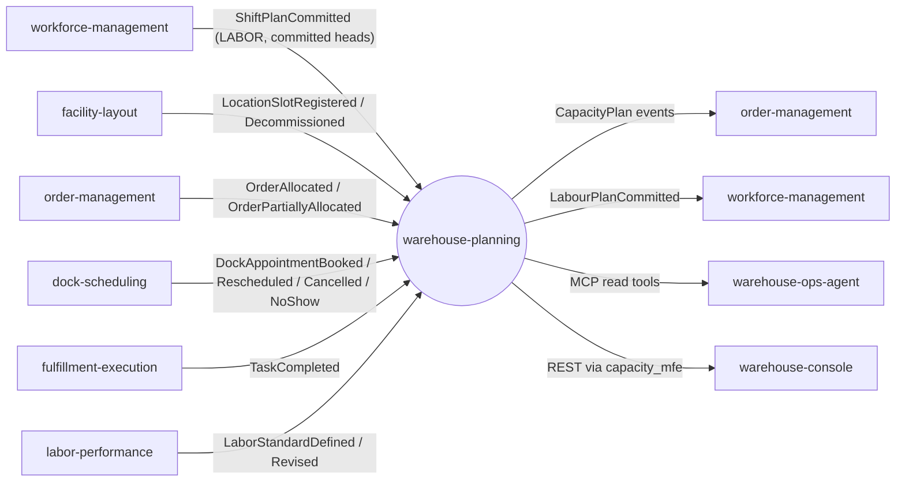

# Bounded context

## Purpose

`warehouse-planning` evaluates whether a warehouse can process the demand
assigned to it. It composes the capacity constraints that sibling contexts and
operators make known, normalizes them to one comparable flow unit, and reports
the effective end-to-end capacity of a process path, the bottleneck step, and
the shortage of a planning window.

Since [ADR 0022](/docs/adr/0022-labour-standards-from-labor-performance) and
[ADR 0023](/docs/adr/0023-workload-forecast-and-labour-plan-move-here) it
also owns the **requirement side** of labour planning: how much labour the
demand needs. A capacity plan states the labour hours each step requires
(from a local copy of labor-performance's engineered standards); the workload
forecast and the shift labour plan, moved here from wes-work-planning, state
the heads a path needs per shift and publish them as `LabourPlanCommitted`.
The **supply** (who is available and how many heads are committed) stays in
workforce-management, the standards stay in labor-performance, execution stays
in wes-work-planning, and the process-flow topology in process-path-management.
This context never reads stock and has no solver.

The decision to create it as a separate context (rather than extending an
existing service) is [ADR 0001](/docs/adr/0001-warehouse-planning-bounded-context):
`workforce-management` explicitly stops at the path boundary, and no other
context combined labor, station and location constraints.

## Context map

ADR 0001 records the intended relationships (Customer/Supplier unless noted);
ADR 0004 added demand ingestion. The full slice of the context map, with the
DDD pattern of every edge and its code evidence, is on the
[Context map](/docs/ddd/context-map) page.

| Relationship | Direction | Status |
| --- | --- | --- |
| `workforce-management` to `warehouse-planning` | labor via Kafka (`ShiftPlanCommitted`): a LABOR constraint, and for a line with a `shift_id` the committed heads the labour plan drift compares | implemented (consumer; drift since ADR 0023) |
| `labor-performance` to `warehouse-planning` | engineered labour standards via Kafka (`LaborStandardDefined`, `LaborStandardRevised`), a local copy | implemented (consumer, always on; ADR 0022) |
| `warehouse-planning` to `workforce-management` | the shift labour requirement via Kafka (`LabourPlanCommitted`) | implemented (producer); workforce-management keeps a copy and proposes heads from it (its ADR 0043) |
| `facility-layout` to `warehouse-planning` | storage positions and stations via Kafka (`LocationSlotRegistered`, `LocationSlotDecommissioned`) | implemented (consumer, tally only) |
| `order-management` to `warehouse-planning` | expected demand via Kafka (`OrderAllocated`, `OrderPartiallyAllocated`) | implemented (consumer, always on; ADR 0004, ADR 0016) |
| `dock-scheduling` to `warehouse-planning` | inbound labour demand via Kafka (`DockAppointmentBooked`, `DockAppointmentRescheduled`, `DockAppointmentCancelled`, `DockAppointmentNoShow`), attributed to the events' `site_id`, priced by an operator-declared inbound labour standard | implemented (consumer, always on; ADR 0017, source switched from `inbound-receiving` by ADR 0020) |
| `fulfillment-execution` to `warehouse-planning` | observed capacity via Kafka (`TaskCompleted`), an advisory planned-versus-observed variance | implemented (consumer, always on; ADR 0017) |
| `process-path-management` to `warehouse-planning` | `path_id` as a loose human cross-reference | deliberately **not** consumed (ADR 0001 Addendum) |
| `warehouse-planning` to `order-management` | `CapacityPlanCreated`, `CapacityPlanPublished`, `CapacityShortageDetected`, `BottleneckDetected` | implemented (producer); `order-management` consumes `CapacityPlanCreated`, `CapacityPlanPublished` and `CapacityShortageDetected` and ignores `BottleneckDetected` (its `planned_capacity_consumer.go`, ADR 0031 there) |
| `warehouse-planning` to `warehouse-ops-agent` | read-only MCP tools (`get_process_path_capacity`, `get_capacity_plan`, `get_storage_capacity`, `list_station_standards`) | implemented (the agent's MCP client) |
| `warehouse-planning` to `warehouse-console` | REST through the `capacity_mfe` remote in `web/` | implemented |
| `wes-work-planning` | handed its charge forecast and path plan over (ADR 0023, its ADR 0049: its `/charge` and `/plan` routes answer `410`) | no runtime edge; execution stays there |
| `network-fulfillment` | demand ingestion | planned in ADR 0001, **not** implemented (observed capacity feedback from `fulfillment-execution` and inbound demand from the dock appointments landed in ADR 0017 and moved to `dock-scheduling` in ADR 0020; automatic adjustment of planned capacity from observed capacity stays a later ADR) |
| `product-master` | none: SKU master data (handling classification, unit dimensions) is not a capacity input | no relationship in either direction |

## No live cross-context lookup

The service never makes a synchronous REST or MCP call to a sibling bounded
context to answer a capacity question. Capacity-relevant facts are ingested
as published Kafka events and kept as local read models, so a capacity
decision stays available and fast even when an upstream context is degraded.
`inventory-storage` stock levels are explicitly excluded: stock is not
capacity.

## Runtime surface

- `cmd/api` serves REST on `HTTP_ADDR` (default `:8080`), runs the Kafka
  consumers and the outbox relay, and applies the idempotent migrations on
  start. The workload forecast and labour plan routes are served here only
  (no MCP tool, no A2A skill; ADR 0023 decision 7).
- `cmd/mcp` serves an MCP server (14 tools) over Streamable HTTP on `MCP_ADDR`
  (default `:8090`, mounted at `/` and `/mcp`, with `GET /healthz`). It uses
  the same use cases and repositories as REST, never dials Kafka and never
  starts the outbox relay: the relay in `cmd/api` drains the outbox rows that
  MCP create and publish calls insert.
- `cmd/planning-projector` (admin `:8091`, `/healthz` `/readyz`) is the analytics
  read side's only writer: it consumes `warehouse.warehouse-planning.analytics`
  and projects into the separate analytical database (ADR 0005).
  `cmd/planning-reports` (`:8092`, `/healthz`, `/readyz`) serves the four read-only
  `/reports/...` endpoints from it (`bottleneck-frequency`, `shortage-trend`,
  `plan-throughput` and `freshness`).
- Postgres and Kafka are the only runtime ([ADR 0016](/docs/adr/0016-postgres-and-kafka-are-the-only-runtime)):
  `cmd/api` and `cmd/mcp` exit at boot without `DATABASE_URL` (and `cmd/api`
  without `KAFKA_BROKERS` and its consumer groups); the analytics binaries
  require `ANALYTICS_DATABASE_URL`. There is no in-memory mode.
- A Helm chart (`charts/warehouse-planning`) deploys the `api` component, and
  optionally the `mcp`, `frontend` and analytics components (off by default).

Telemetry is pushed over OTLP (`OTEL_EXPORTER_OTLP_ENDPOINT`, ADR 0011) by
all four binaries, `cmd/api`, `cmd/mcp`, `cmd/planning-projector` (since
ADR 0015) and `cmd/planning-reports`; no binary serves a `/metrics` endpoint.
