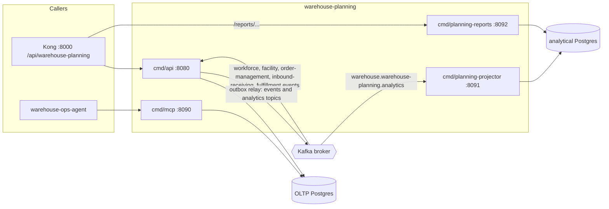

# Runtime and integration mechanics

## Layers

Hexagonal architecture, enforced by architecture tests in
`internal/architecture`:

| Layer | Path |
| --- | --- |
| Domain | `internal/domain/{processcapacity,capacityplan,processpath,demand}` |
| Application (use cases, ports) | `internal/application/{usecases,ports,outbox,tally}` |
| Inbound adapters | `internal/adapters/inbound/{http,kafka,mcp}` |
| Outbound adapters | `internal/adapters/outbound/{postgres,memory,kafka,outbox,analyticsstore,telemetry}` |
| CloudEvents helper | `internal/adapters/kafka/cloudevents` |
| Analytics read side | `internal/analytics/report` (never imported by the OLTP layers) |
| Composition roots | `cmd/api`, `cmd/mcp`, `cmd/planning-projector`, `cmd/planning-reports` |

The [class diagrams](/docs/ddd/class-diagram) show the domain types and the
ports with their adapters.

## Binaries, ports and data stores

| Binary | Role | Port (default) | Probes | Data store |
| --- | --- | --- | --- | --- |
| `cmd/api` | REST API, the five domain Kafka consumers, the outbox relay | `HTTP_ADDR` `:8080` | `/healthz`, `/readyz` | OLTP Postgres (`DATABASE_URL`, required) and Kafka (`KAFKA_BROKERS`, required) |
| `cmd/mcp` | MCP server (Streamable HTTP, 14 tools); writes outbox rows but never relays them | `MCP_ADDR` `:8090` (`/` and `/mcp`) | `/healthz` | the same OLTP Postgres (`DATABASE_URL`, required) |
| `cmd/planning-projector` | the only writer of the analytical database, fed by `warehouse.warehouse-planning.analytics` | `ADMIN_ADDR` `:8091` (admin only) | `/healthz`, `/readyz` (analytical Postgres ping and Kafka metadata) | analytical Postgres (`ANALYTICS_DATABASE_URL`, read-write) |
| `cmd/planning-reports` | read-only `GET /reports/...` over the analytical database | `HTTP_ADDR` `:8092` | `/healthz`, `/readyz` (analytical Postgres ping) | analytical Postgres (`ANALYTICS_DATABASE_URL`, read-only transactions) |

`cmd/api` and `cmd/mcp` both run the OLTP migrations at boot
(`MIGRATIONS_DATABASE_URL`, falling back to `DATABASE_URL`); the projector runs
the analytical ones. Every variable is listed on
[Configuration](/docs/operations/configuration), and the probes are explained
in the [runbook](/docs/operations/runbook).

Source: `cmd/api/main.go`, `cmd/mcp/main.go`, `cmd/mcp/router.go`,
`cmd/planning-projector/main.go`, `cmd/planning-reports/main.go`.
Omits: the DLQ topics, the OTel Collector and the `web/` remote's own nginx
workload.

## Publishing: transactional outbox

There is no dual write. `CreateCapacityPlan` and `PublishCapacityPlan` each run
one unit of work that saves the aggregate **and** inserts the already encoded
CloudEvents into `outbox_events`. The CloudEvents `id` is minted once at
encoding and persisted, so a relay retry republishes the same bytes and id.

The relay in `cmd/api` drains the table every `OUTBOX_RELAY_INTERVAL` (default
`1s`), claiming rows `FOR UPDATE SKIP LOCKED` in id order, sending one at a
time and stopping at the first failure, so a later event for a plan never
overtakes an earlier one that is still being retried. A row that has failed
`OUTBOX_MAX_ATTEMPTS` times (default 20) is excluded from claims and stays in
the table until an operator re-arms it, so later rows, including the same
plan's, overtake it ([ADR 0013](/docs/adr/0013-outbox-relay-attempt-cap)).
Each row carries the writing request's W3C `traceparent`, which the relay
sends as a Kafka header ([ADR 0014](/docs/adr/0014-trace-context-crosses-the-outbox)).
Delivery is at-least-once; consumers dedupe on `id`.
The relay always runs and always publishes to Kafka: `KAFKA_BROKERS` is
required and `EVENT_PUBLISHER` may only be `kafka` (`log` is a boot error; the
log sink was removed, [ADR 0016](/docs/adr/0016-postgres-and-kafka-are-the-only-runtime)).
Kafka is dialled lazily by the first send, never at boot. The process exits
non-zero when the relay or a consumer stops on its own, so the pod restarts.

## Consuming: at-least-once with an atomic effect

- Offsets are committed only after a message was handled successfully
  (`FetchMessage` plus `CommitMessages`); transient failures retry the same
  message with capped exponential backoff.
- The processed-event claim (keyed by consumer and CloudEvents id) and every
  side effect commit or roll back together in one unit of work, so a
  rolled-back handling un-claims and the redelivery is processed.
- Only transient or infrastructure failures return an error. Deterministic
  problems (not a CloudEvent, unknown type, malformed payload, duplicate id,
  domain-validation rejections) are skipped.
- Consumer group ids come from environment variables
  (`LABOR_CAPACITY_CONSUMER_GROUP`, `STORAGE_CAPACITY_CONSUMER_GROUP`,
  `DEMAND_CONSUMER_GROUP`, `INBOUND_DEMAND_CONSUMER_GROUP`,
  `OBSERVED_CAPACITY_CONSUMER_GROUP`, and the projector's
  `ANALYTICS_CONSUMER_GROUP`), never from string literals. Every consumer is
  always on ([ADR 0016](/docs/adr/0016-postgres-and-kafka-are-the-only-runtime)):
  a missing group, or a missing `DEMAND_SITE_ID` (the one site the order,
  dock-appointment and task-completion events are attributed to), is a boot
  error.

Dead-lettering ([ADR 0007](/docs/adr/0007-outbox-and-resilient-consumers) §3,
`internal/adapters/inbound/kafka/deadletter.go`): the five domain consumers
retry a transient failure on the same message up to 5 times, then publish it to
`<topic>.dlq` (`warehouse.workforce.events.dlq`,
`warehouse.facility.events.dlq`, `warehouse.order-management.events.dlq`,
`warehouse.inbound-receiving.events.dlq`, `warehouse.fulfillment.events.dlq`) with
`x-dlq-*` headers and commit past it. The two ADR 0017 consumers (dock
appointments, task completions) also dead-letter a *deterministic* failure (not
CloudEvents 1.0, malformed or unusable payload) at once instead of skipping it. The DLQ publish itself is retried until it
succeeds, so nothing is silently dropped. The analytics projector is different
by design ([ADR 0005](/docs/adr/0005-analytics-read-side)): a transient failure
is retried forever and never dead-lettered; only a known type with an unusable
payload or a deterministic store rejection goes to
`warehouse.warehouse-planning.analytics.dlq`.

## CloudEvents envelope

Every Kafka message is a CloudEvents 1.0 event in structured content mode with
the header `content-type: application/cloudevents+json; charset=UTF-8`. See the
[event catalogue](/docs/api-reference/events) for attributes and types.

## MCP

`cmd/mcp` exposes 14 tools (budget is 14, pinned by `maxTools` in
`internal/adapters/inbound/mcp/governance_test.go`):
`register_process_capacity_constraint`, `get_effective_process_capacity`,
`register_process_path`, `get_process_path_capacity`, `create_capacity_plan`,
`publish_capacity_plan`, `get_capacity_plan`, `declare_station_standard`,
`list_station_standards`, `get_storage_capacity`, `get_expected_demand`,
`declare_inbound_labour_standard`, `get_inbound_demand` and
`get_capacity_plan_variance` (ADR 0017). Arguments are snake_case, matching the REST bodies;
failures are MCP tool errors whose text is `<slug>: <message>` using the REST
problem slugs.
